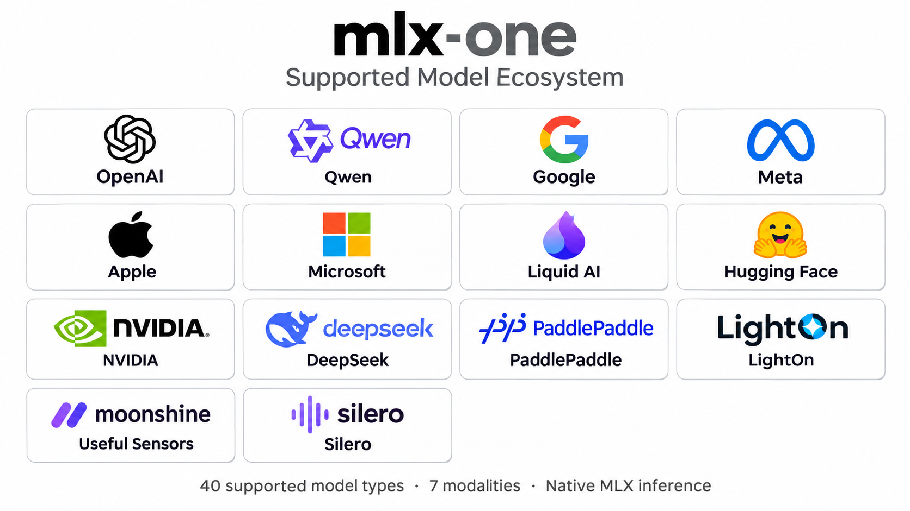
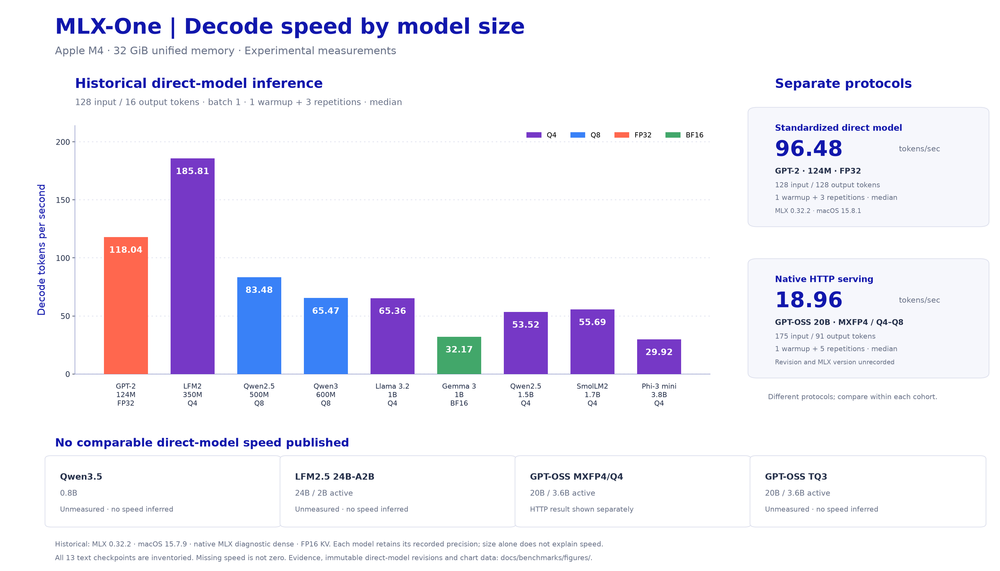
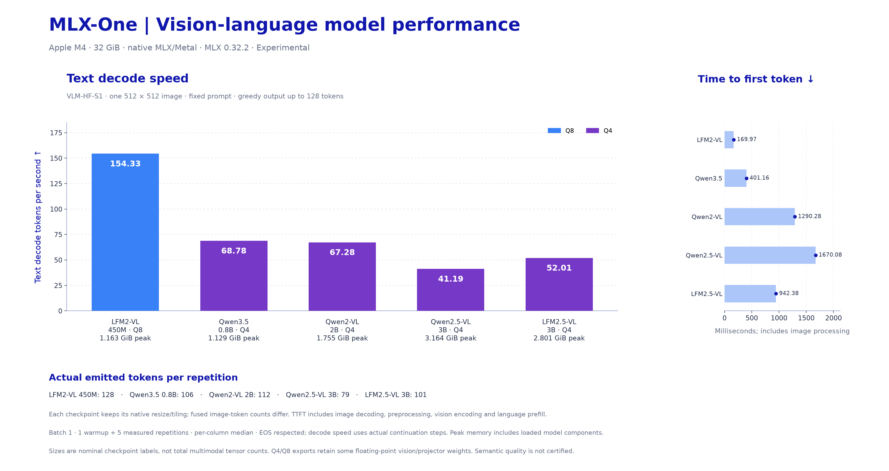
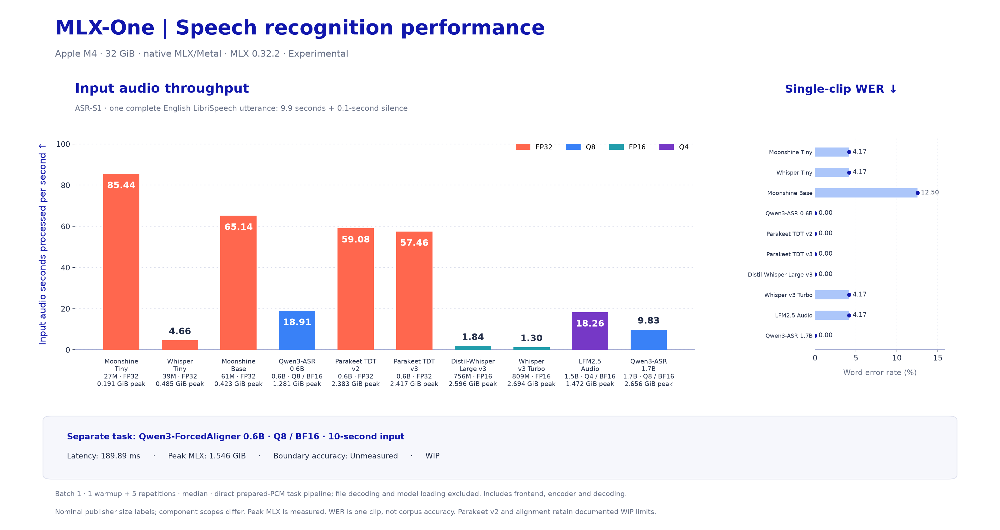
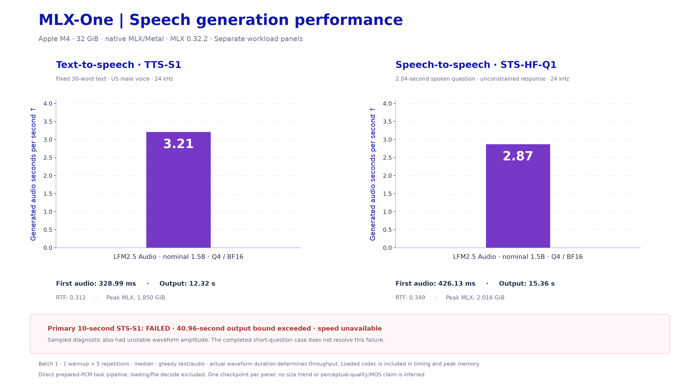
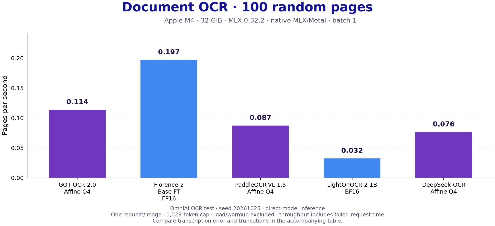
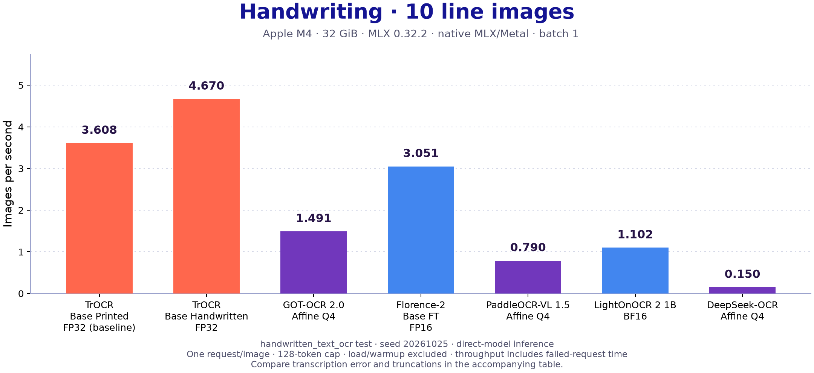
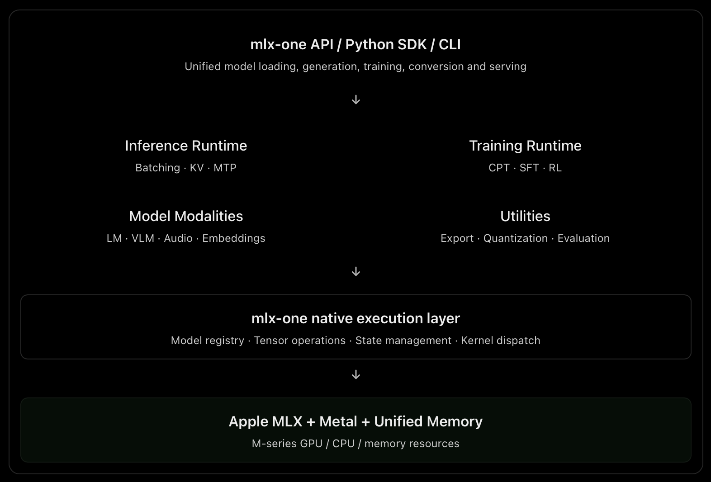
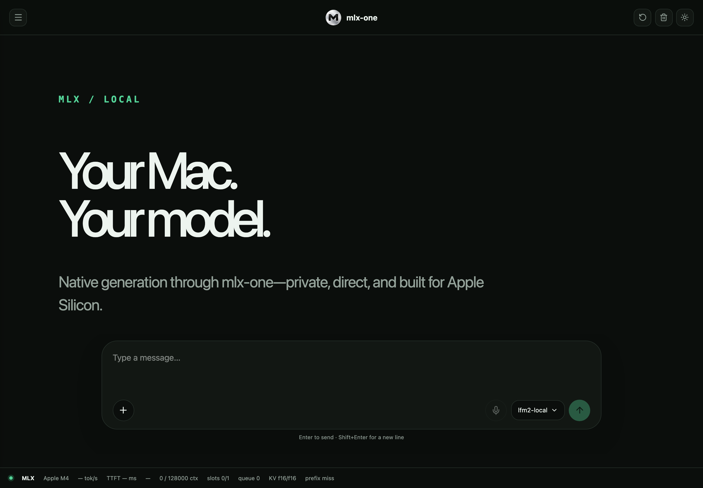

<p align="center">
  
</p>

<h1 align="center">mlx-one</h1>

<p align="center"><strong>One stack. Native MLX. Built for Apple Silicon.</strong></p>

<p align="center">
  A unified, native MLX stack for language, vision-language, embeddings,
  audio-language, speech, segmentation and classification models on Apple Silicon.
</p>

<p align="center">
  <a href="https://github.com/SSusantAchary/mlx-one/actions/workflows/ci.yml"></a>
  <a href="https://www.python.org/"></a>
  <a href="LICENSE"></a>
  
  
</p>

[**Quick Start**](#quick-start) | [**Performance**](#model-performance) · [VLM](#vision-language-model-performance) · [Audio](#audio-model-performance) · [OCR](#ocr-model-performance) | [**Models**](#supported-modalities-and-models) | [**Architecture**](#architecture) | [**APIs**](#python-cli-and-http-apis) | [**Documentation**](#documentation)

MLX-One is a native inference library built on Apple's MLX framework for Apple
Silicon. It brings text generation, vision-language inference, audio, OCR,
embeddings and segmentation into one extensible stack, with shared model
loading, execution and developer tooling.

## Why MLX-One?

- **Native model implementations:** model math, safe checkpoint loading,
  tokenization and generation live inside MLX-One.
- **One developer interface:** use Python, the CLI or HTTP for implemented tasks,
  with shared request lifecycle and evidence records.
- **Built for Apple Silicon:** MLX, Metal and unified memory underpin execution;
  memory planning helps choose bounded workloads for a device.
- **Extensible architectures:** configuration-driven registration and reusable
  components support language, vision, audio and retrieval families.
- **Optional acceleration:** MLXBoost provides an opt-in host-overhead optimization
  for eligible profiles, with explicit fallback and experimental status.

Hugging Face supplies configuration, tokenizer/processor assets and safe
`safetensors` checkpoints. Native inference runs through MLX-One and Apple MLX.

## Model support and release

<p align="center">
  <a href="status_models_testing.md">
    
  </a>
</p>

**0.1.1 approved for release · 8 November 2026.** All **40 registered native
model types** have passing primary-workflow records across **seven modalities**.
Each supported entry identifies its checkpoint, immutable revision, precision,
operations and saved result. Model tests, relevant public interfaces and package
checks back the support decision.

**Validation:** 2,573 tests passed, 9 subtests passed, 95 optional tests skipped
on Apple M4 / 32 GiB with MLX/Metal 0.32.2. Downloaded qualification weights were
removed after recording results. Accuracy diagnostics and known limits remain
visible beside the supported workflows.

[All 40 supported models](status_models_testing.md) ·
[0.1.1 release notes](docs/releases/0.1.1.md) ·
[Coverage and progress](https://ssusantachary.github.io/mlx-one/insights/).

Installation examples target **0.1.1**. Check [PyPI availability](https://pypi.org/project/mlx-one/#history)
before installing; if the release is not available yet, use the
[source installation](docs/getting-started.md#source-installation-for-development)
after these changes reach the repository.

## Key Capabilities

| Capability | What is implemented |
| --- | --- |
| Text generation | Cached decoding, seeded sampling, stop sequences, streaming and chat templates |
| Multimodal inference | Native image/text, speech, OCR and segmentation workflows within family-specific limits |
| Retrieval | Embedding vectors, instructed queries, similarity and native Qwen3 reranking |
| Developer access | Context-managed Python engine, task CLI, local Web UI and HTTP/SSE serving |
| Inspection and planning | Safe artifact inspection, hardware profiles and workload memory estimates |
| Training and evaluation | Experimental LoRA/QLoRA SFT, dataset validation, adapter export and evidence tooling |

Task availability varies by checkpoint and interface. See the
[model guides](docs/models/index.md) for supported inputs and limitations.

## Quick Start

### Installation

Use Python 3.10+ on an Apple Silicon Mac running macOS 15+ for model execution.
MLX and MLX Metal are pinned to 0.32.2; Python 3.12.11 is the tested development
version. Install the 0.1.1 release from PyPI once it is published:

```bash
python -m pip install "mlx-one==0.1.1"
```

For the HTTP server, vision and OCR dependencies:

```bash
python -m pip install "mlx-one[server,vision,ocr]==0.1.1"
mlx-one --version
```

For optional dependencies, audio/video decoding requirements and tested
constraints, see [getting started](docs/getting-started.md) and the
[dependency policy](requirements/README.md). For editable development setup, use the
[source installation](docs/getting-started.md#source-installation-for-development).
See the [0.1.1 release notes](docs/releases/0.1.1.md) for validation and
[PyPI files](https://pypi.org/project/mlx-one/0.1.1/#files) for published artifacts.

### Load a text checkpoint and generate

The native GPT-2 checkpoint has a passing primary-workflow record in the
[support inventory](status_models_testing.md). The engine loads the model
on entry and releases its resources on exit:

```python
from mlx_one import Engine

with Engine(model="openai-community/gpt2") as engine:
    result = engine.generate("The future of local AI is", max_tokens=64)
    print(result.text)
```

A local snapshot path also works. Use `revision` to pin an immutable checkpoint
and `offline=True` when all required assets are already cached.

### Run the CLI

```bash
mlx-one doctor
mlx-one generate openai-community/gpt2 "The future of local AI is" \
  --max-tokens 64 --temperature 0.8 --top-p 0.95 --seed 0
```

Add `--stream` for incremental text or `--offline` for cached/local assets.

### Start the HTTP server

```bash
python -m pip install "mlx-one[server]==0.1.1"
mlx-one serve LiquidAI/LFM2-350M --inference-mode reference_dense \
  --host 127.0.0.1 --port 8888 --alias lfm2-local
```

Open `http://127.0.0.1:8888` for the bundled chat UI. The same process exposes
OpenAI-compatible endpoints at `/v1`. The [server guide](docs/ui.md) covers model
aliases, optional Bearer authentication and runtime configuration.

<!-- model-performance-summary:start -->
## Model Performance

Historical **direct-model native MLX** measurements on Apple M4 / 32 GB, batch 1; 128 actual input / 16 actual output tokens, one warmup and three measured repetitions; per-column medians. Fresh FP16 KV, no prefix reuse; full-sequence logits.

MLX / Metal 0.32.2 / 0.32.2; macOS-15.7.9-arm64-arm-64bit; Python 3.12.11. TTFT includes prefill and first-token selection. Decode excludes that first token.

| Model | Precision | Hardware | TTFT (ms) | Prefill tok/s | Decode tok/s |
| --- | --- | --- | ---: | ---: | ---: |
| openai-community/gpt2 | FP32 | Apple M4 / 32 GB | 19.04 | 6722.29 | 118.04 |
| Qwen/Qwen2.5-0.5B-Instruct | Affine Q8 (group 64) | Apple M4 / 32 GB | 63.94 | 2001.96 | 83.48 |
| Qwen/Qwen3-0.6B | Affine Q8 (group 64) | Apple M4 / 32 GB | 100.39 | 1275.02 | 65.47 |
| LiquidAI/LFM2-350M | Affine Q4 (group 64) | Apple M4 / 32 GB | 40.24 | 3180.66 | 185.81 |
| HuggingFaceTB/SmolLM2-1.7B-Instruct | Affine Q4 (group 64) | Apple M4 / 32 GB | 333.28 | 384.06 | 55.69 |
| meta-llama/Llama-3.2-1B-Instruct | Affine Q4 (group 64) | Apple M4 / 32 GB | 341.58 | 374.73 | 65.36 |
| Qwen/Qwen2.5-1.5B-Instruct | Affine Q4 (group 64) | Apple M4 / 32 GB | 311.26 | 411.23 | 53.52 |
| google/gemma-3-1b-it | BF16 | Apple M4 / 32 GB | 189.47 | 675.56 | 32.17 |
| microsoft/Phi-3-mini-4k-instruct | Affine Q4 (group 64) | Apple M4 / 32 GB | 801.79 | 159.64 | 29.92 |

Affine Q4/Q8 use group size 64. These bounded experimental measurements are not release qualification, full-context validation or Python/HTTP throughput. Different model architectures and precisions affect comparison.



The chart labels the historical cohort and separate standardized GPT-2 result. [Full tables and exact provenance](docs/benchmarks/text-performance.md), [methodology](docs/benchmarks/README.md) and [chart reproduction](docs/benchmarks/figures/README.md) retain all records. Standardized 128/128 runs, [HTTP serving](docs/benchmarks/http-performance.md), [VLM](docs/benchmarks/vlm/performance.md), [audio](docs/benchmarks/audio/performance.md) and [OCR](docs/benchmarks/ocr/performance.md) use separate protocols.
<!-- model-performance-summary:end -->

### GPT-OSS native HTTP serving

Measured on Apple M4 with 32 GB unified memory, Python 3.12, using the native MLX-One server on 2026-10-23. One warmup followed by five sequential tool-call requests; 175 prompt tokens and 91 generated tokens per request. Throughput and TTFT are per-column medians; memory is the observed peak. This serving workload uses a separate protocol from the direct-model text table above.

| Model name | Parameters | Configured context (tokens) | Quantization/precision | Prefill tokens/sec | Decode tokens/sec | Native first-token time (ms) | Peak MLX memory (GiB) |
|---|---|---:|---|---:|---:|---:|---:|
| [mlx-community/gpt-oss-20b-MXFP4-Q4](docs/validation/gpt-oss-kilo-2026-10-23.json) | 20B / 3.6B active | 131,072 | Mixed MXFP4 / affine Q4–Q8 | **75.95** | **18.96** | 2355.38 | 10.608 |

Native first-token time includes hidden analysis; the median first actionable tool delta arrived at **7.127 seconds**, after argument validation. The configured 131,072-token context was not tested at its full length. See the [full measurements and methodology](docs/GPT_OSS_KILO_COMPATIBILITY.md#measured-performance). Standardized direct-model 128/128 coverage remains unchanged.

The historical serving report does not record an immutable local checkpoint revision or MLX version; it cannot qualify the current pinned GPT-OSS targets. See [HTTP provenance](docs/benchmarks/http-performance.md).


<!-- MLX-ONE-VLM-BENCHMARK-START -->
## Vision-Language Model Performance

Actual **direct-model native MLX/Metal** inference on pinned checkpoint revisions. These are image-inference measurements; Python Engine, CLI and HTTP serving overhead are separate. Functional and quality limits are recorded with the evidence.

**VLM-HF-S1 v1:** one 512 × 512 padded image from [Hugging Face documentation-images](https://huggingface.co/datasets/huggingface/documentation-images), with dataset revision and image hashes pinned in the [workload manifest](benchmarks/vlm/hf-images.json). Batch 1, fixed prompt, greedy generation up to 128 emitted tokens; one warmup and five repetitions, per-column median. EOS is respected and actual output counts determine speed. Each checkpoint retains its own resize/tiling. TTFT includes image decoding/preprocessing; prefill combines vision encoding, projection and language prefill. “Vision processing” means image decoding/preprocessing only.

Q4/Q8 denote the published checkpoint format; vision or projector modules may retain floating-point weights.



[VLM size-versus-speed scatter plot](docs/benchmarks/figures/vlm-model-size-vs-decode.svg) · [VLM chart SVG](docs/benchmarks/figures/vlm-model-performance.svg) · [Chart data and reproduction](docs/benchmarks/figures/README.md#vlm-and-audio-charts)

**Measured hardware:** Apple M4, 32 GiB; macOS-15.8.1-arm64-arm-64bit; MLX 0.32.2; Python 3.12.11. Separate execution cohort.

| Model | Precision | Images | Vision processing (ms) | Prefill TPS | Decode TPS | TTFT (ms) | Peak MLX memory (GiB) | Scores |
|---|---|---:|---:|---:|---:|---:|---:|---|
| [Qwen2-VL 2B](docs/benchmarks/vlm/results/V01-VLM-HF-S1.json) | Q4 | 1 | 6.05 | **279.68** | **67.28** | 1290.28 | 1.755 | [Scores](docs/benchmarks/vlm/results/V01-VLM-HF-S1.json) |
| [Qwen2.5-VL 3B](docs/benchmarks/vlm/results/V02-VLM-HF-S1.json) | Q4 | 1 | 6.05 | **215.86** | **41.19** | 1670.08 | 3.164 | [Scores](docs/benchmarks/vlm/results/V02-VLM-HF-S1.json) |
| [Qwen3.5 0.8B](docs/benchmarks/vlm/results/V03-VLM-HF-S1.json) | Q4 | 1 | 4.81 | **717.75** | **68.78** | 401.16 | 1.129 | [Scores](docs/benchmarks/vlm/results/V03-VLM-HF-S1.json) |
| [LFM2-VL 450M](docs/benchmarks/vlm/results/V04-VLM-HF-S1.json) | Q8 | 1 | 7.16 | **1739.05** | **154.33** | 169.97 | 1.163 | [Scores](docs/benchmarks/vlm/results/V04-VLM-HF-S1.json) |
| [LFM2.5-VL 3B](docs/benchmarks/vlm/results/V05-VLM-HF-S1.json) | Q4 | 1 | 7.37 | **300.73** | **52.01** | 942.38 | 2.801 | [Scores](docs/benchmarks/vlm/results/V05-VLM-HF-S1.json) |

**Actual fused input / emitted output tokens per repetition:** Qwen2-VL 2B: 359 / 112; Qwen2.5-VL 3B: 359 / 79; Qwen3.5 0.8B: 284 / 106; LFM2-VL 450M: 282 / 128; LFM2.5-VL 3B: 281 / 101.


High-resolution (1024 × 1024), four-image and OCR workloads remain separate. The HF image protocol is not pooled with the earlier synthetic-image protocol. See the [methodology and coverage](docs/benchmarks/vlm/README.md), [pinned checkpoint inventory](docs/benchmarks/vlm/benchmark_plan.json), and [manual download/inference/benchmark runbook](docs/VLM_TESTING.md). Text-model measurements above use different protocols. See the [checkpoint smoke and cleanup report](docs/validation/vlm-hf-2026-10-24/report.md).
<!-- MLX-ONE-VLM-BENCHMARK-END -->


<!-- MLX-ONE-AUDIO-BENCHMARK-START -->
## Audio Model Performance

Historical native audio performance. Values below are validated measurements; “—” means unavailable. Recognition uses one pinned English LibriSpeech utterance (9.9 seconds, padded to 10); its WER is a single-clip check, not corpus accuracy. See the linked raw evidence.

Protocol: batch 1, one warmup, five repetitions, median; actual audio durations. ASR uses a fixed 10-second clip (ASR-S1); TTS uses fixed 30-word text (TTS-S1). RTF is processing seconds divided by input audio seconds for ASR, or generated audio seconds for synthesis. Lower RTF is faster. Hardware and MLX version are listed for each measured cohort. Direct-model, Python Engine and full file-pipeline runs remain separate.

### Speech Recognition Performance



[ASR size-versus-throughput scatter plot](docs/benchmarks/figures/audio-model-size-vs-asr.svg) · [ASR chart SVG](docs/benchmarks/figures/audio-asr-performance.svg)

| Model | Precision | Audio (s) | Latency (ms) | RTF ↓ | Audio sec/sec ↑ | WER (%) | Peak MLX (GiB) | Scores |
| --- | --- | --- | --- | --- | --- | --- | --- | --- |
| [Whisper Tiny](docs/benchmarks/audio/results/hf-2026-10-24/A01-ASR-S1.json) | FP32 | 10.000 | 2144.869 | 0.214 | **4.662** | 4.167 | 0.485 | [Scores](docs/benchmarks/audio/results/hf-2026-10-24/A01-ASR-S1.json) |
| [Whisper Large v3 Turbo](docs/benchmarks/audio/results/hf-2026-10-24/A02-ASR-S1.json) | FP16 | 10.000 | 7666.962 | 0.767 | **1.304** | 4.167 | 2.694 | [Scores](docs/benchmarks/audio/results/hf-2026-10-24/A02-ASR-S1.json) |
| [Distil-Whisper Large v3](docs/benchmarks/audio/results/hf-2026-10-24/A03-ASR-S1.json) | FP16 | 10.000 | 5433.400 | 0.543 | **1.840** | 0.000 | 2.596 | [Scores](docs/benchmarks/audio/results/hf-2026-10-24/A03-ASR-S1.json) |
| [Moonshine Tiny](docs/benchmarks/audio/results/hf-2026-10-24/A04-ASR-S1.json) | FP32 | 10.000 | 117.038 | 0.012 | **85.443** | 4.167 | 0.191 | [Scores](docs/benchmarks/audio/results/hf-2026-10-24/A04-ASR-S1.json) |
| [Moonshine Base](docs/benchmarks/audio/results/hf-2026-10-24/A05-ASR-S1.json) | FP32 | 10.000 | 153.511 | 0.015 | **65.142** | 12.500 | 0.423 | [Scores](docs/benchmarks/audio/results/hf-2026-10-24/A05-ASR-S1.json) |
| [Qwen3-ASR 0.6B](docs/benchmarks/audio/results/hf-2026-10-24/A06-ASR-S1.json) | Q8 / BF16 | 10.000 | 528.726 | 0.053 | **18.913** | 0.000 | 1.281 | [Scores](docs/benchmarks/audio/results/hf-2026-10-24/A06-ASR-S1.json) |
| [Qwen3-ASR 1.7B](docs/benchmarks/audio/results/hf-2026-10-24/A07-ASR-S1.json) | Q8 / BF16 | 10.000 | 1017.307 | 0.102 | **9.830** | 0.000 | 2.656 | [Scores](docs/benchmarks/audio/results/hf-2026-10-24/A07-ASR-S1.json) |
| [Parakeet TDT v2](docs/benchmarks/audio/results/hf-2026-10-24/A08-ASR-S1.json) | FP32 | 10.000 | 169.265 | 0.017 | **59.079** | 0.000 | 2.383 | [Scores](docs/benchmarks/audio/results/hf-2026-10-24/A08-ASR-S1.json) |
| [Parakeet TDT v3](docs/benchmarks/audio/results/hf-2026-10-24/A09-ASR-S1.json) | FP32 | 10.000 | 174.019 | 0.017 | **57.465** | 0.000 | 2.417 | [Scores](docs/benchmarks/audio/results/hf-2026-10-24/A09-ASR-S1.json) |
| [LFM2.5 Audio 1.5B](docs/benchmarks/audio/results/hf-2026-10-24/A10-ASR-S1.json) | Q4 / BF16 | 10.000 | 547.659 | 0.055 | **18.260** | 4.167 | 1.472 | [Scores](docs/benchmarks/audio/results/hf-2026-10-24/A10-ASR-S1.json) |

Measured on Apple M4, 32 GiB; MLX 0.32.2; native MLX/Metal; direct-model-prepared-pcm; ASR-S1.

### Forced Alignment Performance

| Model | Precision | Audio (s) | Latency (ms) | Mean boundary error (ms) | Peak MLX (GiB) | Scores |
| --- | --- | --- | --- | --- | --- | --- |
| [Qwen3-ForcedAligner 0.6B](docs/benchmarks/audio/results/hf-2026-10-24/A11-ALIGN-S1.json) | Q8 / BF16 | 10.000 | 189.892 | — | 1.546 | [Scores](docs/benchmarks/audio/results/hf-2026-10-24/A11-ALIGN-S1.json) |

Measured on Apple M4, 32 GiB; MLX 0.32.2; native MLX/Metal; direct-model-prepared-pcm; ALIGN-S1.

### Speech Generation Performance



[Speech generation chart SVG](docs/benchmarks/figures/audio-speech-generation.svg) · [Chart data and reproduction](docs/benchmarks/figures/README.md#vlm-and-audio-charts). Speech quality and alignment accuracy retain their documented limits.

| Model | Precision | Task | First audio (ms) | Output (s) | RTF ↓ | Audio sec/sec ↑ | Peak MLX (GiB) | Scores |
| --- | --- | --- | --- | --- | --- | --- | --- | --- |
| [LFM2.5 Audio 1.5B](docs/benchmarks/audio/results/hf-2026-10-24/A12-TTS-S1.json) | Q4 / BF16 | synthesize | 328.986 | 12.320 | 0.312 | **3.207** | 1.850 | [Scores](docs/benchmarks/audio/results/hf-2026-10-24/A12-TTS-S1.json) |
| [LFM2.5 Audio 1.5B](docs/benchmarks/audio/results/hf-2026-10-24/A13-STS-S1.json) | Q4 / BF16 | speech-to-speech | — | — | — | — | — | [Failed; WIP](docs/benchmarks/audio/results/hf-2026-10-24/A13-STS-S1.json) |

Measured on Apple M4, 32 GiB; MLX 0.32.2; native MLX/Metal; direct-model-prepared-pcm; TTS-S1.

### Speech-to-speech: separate short-question workload

**STS-HF-Q1:** a different 2.04-second spoken question from the same pinned dataset, without padding; greedy generation, one warmup, five repetitions, median. This completed case does not replace the failed 10-second STS-S1 run.

| Model | First audio (ms) | Output (s) | RTF ↓ | Audio sec/sec ↑ | Peak MLX (GiB) |
| --- | ---: | ---: | ---: | ---: | ---: |
| [LFM2.5 Audio 1.5B Q4](docs/benchmarks/audio/results/hf-2026-10-24/A13-STS-HF-Q1-direct-model-prepared-pcm.json) | 426.127 | 15.360 | 0.349 | **2.867** | 2.016 |

Apple M4, 32 GiB; MLX 0.32.2; native MLX/Metal; direct-model-prepared-pcm. Experimental; speech quality requires listening review.

Independent alignment boundary accuracy was not measured in this historical cohort; the newer TIMIT timing checks are recorded in the current support inventory. Q4 LFM speech-to-speech exceeded its output bound on this fixture; its sampled diagnostic also had unstable waveform amplitude. No speed is published for that failed task. TTS timings do not establish perceptual quality. Qwen ASR streaming reprocesses a bounded accumulated utterance; it is not a causal streaming encoder. Current Q8 speech support and newer alignment results are in the [support inventory](status_models_testing.md).

[Methodology and coverage](docs/benchmarks/audio/README.md) · [Manual download, Python/CLI/HTTP and benchmark commands](docs/AUDIO_TESTING.md)
<!-- MLX-ONE-AUDIO-BENCHMARK-END -->


<!-- MLX-ONE-OCR-BENCHMARK-START -->
## OCR Model Performance

Experimental native OCR on **100 randomly selected document images** from [OmniAI OCR Benchmark](https://huggingface.co/datasets/getomni-ai/ocr-benchmark). All page models use the same pinned sample (seed 20261025).

**Apple M4, 32 GiB unified memory · MLX 0.32.2 · direct-model inference · native MLX/Metal · batch 1.** One 16-token warmup, then one timed request per image; image-dependent input lengths and a 1,023-token output cap, greedy decoding. Actual token counts are retained in JSON. Latency is the median of completed requests; pages/s is completed pages divided by total inference time, including failed requests. Peak memory is the maximum observed MLX allocation, including weights.



| Model | Precision | Completed | Median latency (s) | Pages/s | Markdown-ref. CER ↓ | Peak MLX (GiB) | Truncated |
|---|---|---:|---:|---:|---:|---:|---:|
| [TrOCR Base Printed](docs/benchmarks/ocr/omni100-20261025/O01.json) | FP32 | [Line crops required](docs/benchmarks/ocr/omni100-20261025/O01.json) | — | — | — | — | — |
| [TrOCR Base Handwritten](docs/benchmarks/ocr/omni100-20261025/O02.json) | FP32 | [Line crops required](docs/benchmarks/ocr/omni100-20261025/O02.json) | — | — | — | — | — |
| [GOT-OCR 2.0](docs/benchmarks/ocr/omni100-20261025/O03.json) | Affine Q4 | [97/100](docs/benchmarks/ocr/omni100-20261025/O03.json) | 12.42 | **0.114** | 74.5% | 1.673 | 56 |
| [Florence-2 Base FT](docs/benchmarks/ocr/omni100-20261025/O04.json) | FP16 | [97/100](docs/benchmarks/ocr/omni100-20261025/O04.json) | 6.60 | **0.197** | 78.3% | 1.201 | 61 |
| [PaddleOCR-VL 1.5](docs/benchmarks/ocr/omni100-20261025/O05.json) | Affine Q4 | [97/100](docs/benchmarks/ocr/omni100-20261025/O05.json) | 13.87 | **0.087** | 59.8% | 1.560 | 53 |
| [LightOnOCR 2 1B](docs/benchmarks/ocr/omni100-20261025/O06.json) | BF16 | [97/100](docs/benchmarks/ocr/omni100-20261025/O06.json) | 31.53 | **0.032** | 67.7% | 8.661 | 64 |
| [DeepSeek-OCR](docs/benchmarks/ocr/omni100-20261025/O07.json) | Affine Q4 | [97/100](docs/benchmarks/ocr/omni100-20261025/O07.json) | 13.59 | **0.076** | 51.2% | 3.810 | 41 |

CER uses NFKC and whitespace normalization against Markdown references; formatting and reading order affect this score, which can exceed 100%. Failed requests count as empty predictions. This is an MLX-One corpus test, separate from OmniAI’s official leaderboard and the synthetic OCR-S* protocol.

TrOCR requires annotated line crops, absent from this page dataset. PaddleOCR-VL uses direct page transcription; its separate layout pipeline is not included. No layout accuracy or JSON extraction score is claimed by this page test.

[Methodology, per-image predictions and cleanup evidence](docs/benchmarks/ocr/omni100-20261025/README.md) · [OCR limitations and manual commands](docs/OCR_TESTING.md)

### Handwriting: 10 line images

The same seeded sample of 10 test-split images from [handwritten_text_ocr](https://huggingface.co/datasets/toghrultahirov/handwritten_text_ocr). One 16-token warmup; one request per image; image-dependent input lengths; 128-token output cap. Micro CER/WER use the supplied plain-text references after NFKC and whitespace normalization; failed requests count as empty outputs.

**Apple M4, 32 GiB · MLX 0.32.2 · native MLX/Metal · direct-model inference · batch 1.**



| Model | Precision | Completed | Median latency (s) | Images/s | CER ↓ | WER ↓ | Peak MLX (GiB) | Truncated |
|---|---|---:|---:|---:|---:|---:|---:|---:|
| [TrOCR Base Printed (printed baseline)](docs/benchmarks/ocr/hand10-20261025/O01.json) | FP32 | [10/10](docs/benchmarks/ocr/hand10-20261025/O01.json) | 0.27 | **3.608** | 80.6% | 100.0% | 1.488 | 0 |
| [TrOCR Base Handwritten](docs/benchmarks/ocr/hand10-20261025/O02.json) | FP32 | [10/10](docs/benchmarks/ocr/hand10-20261025/O02.json) | 0.21 | **4.670** | 4.4% | 10.6% | 1.488 | 0 |
| [GOT-OCR 2.0](docs/benchmarks/ocr/hand10-20261025/O03.json) | Affine Q4 | [10/10](docs/benchmarks/ocr/hand10-20261025/O03.json) | 0.67 | **1.491** | 40.6% | 94.7% | 1.673 | 0 |
| [Florence-2 Base FT](docs/benchmarks/ocr/hand10-20261025/O04.json) | FP16 | [10/10](docs/benchmarks/ocr/hand10-20261025/O04.json) | 0.30 | **3.051** | 97.9% | 143.6% | 1.201 | 1 |
| [PaddleOCR-VL 1.5](docs/benchmarks/ocr/hand10-20261025/O05.json) | Affine Q4 | [10/10](docs/benchmarks/ocr/hand10-20261025/O05.json) | 1.13 | **0.790** | 13.8% | 43.6% | 1.540 | 0 |
| [LightOnOCR 2 1B](docs/benchmarks/ocr/hand10-20261025/O06.json) | BF16 | [10/10](docs/benchmarks/ocr/hand10-20261025/O06.json) | 0.98 | **1.102** | 6.9% | 33.0% | 2.766 | 0 |
| [DeepSeek-OCR](docs/benchmarks/ocr/hand10-20261025/O07.json) | Affine Q4 | [10/10](docs/benchmarks/ocr/hand10-20261025/O07.json) | 6.68 | **0.150** | 24.7% | 48.9% | 3.810 | 0 |

TrOCR Printed is an out-of-domain baseline. Page models process the same cropped lines in their OCR mode; this small sample is not a general handwriting qualification. Handwriting timings are separate from the 100-page workload. [Protocol, predictions, truncations and coverage](docs/benchmarks/ocr/hand10-20261025/README.md).

<!-- MLX-ONE-OCR-BENCHMARK-END -->


## Additional Modality Performance

**Native task latency (2026-11-03) — Apple M4 / 32 GiB, macOS 15.8.1, Python 3.12.11,
MLX 0.32.2, FP32.** One process, one excluded warmup, 20 timed Python task
calls per row; model loading excluded. Timing includes preparation and
synchronized execution. Workloads are distinct; these are not HTTP or
concurrent-serving rates. p95 uses the nearest-rank method.

| Task | Workload | Median (ms) | p95 (ms) |
| --- | --- | ---: | ---: |
| DistilBERT SST-2 | One text | 14.95 | 17.58 |
| BERT NER | One text, SIMPLE aggregation | 18.90 | 26.14 |
| CLIP ViT-B/32 | One image, two labels | 80.19 | 89.68 |
| Silero VAD | One second of decoded mono 16 kHz audio | 16.35 | 22.97 |

[Task measurement protocol and raw-run locators](docs/native_tasks/task-performance.md)
retain exact workload and provenance details. Current model support is recorded
in the [40-model inventory](status_models_testing.md); older quality measurements
and rejected optional profiles remain in the
[task evidence](docs/experimental/native-tasks.md).

| Modality | Available performance evidence | Remaining measurement gap |
| --- | --- | --- |
| Embeddings and reranking | No verified latency/throughput measurement in the current published evidence | Latency, throughput and memory unavailable; see [retrieval scope](docs/models/index.md#retrieval-guides) |
| SAM3 segmentation and tracking | Approximately 8.41 GB peak MLX allocation in controlled 32-frame single-object comparisons on M4 / 32 GB | Isolated latency/throughput not measured; [fixture report](docs/sam3-qualification-m4-32gb.md) is not a general tracking benchmark |


## Supported Modalities and Models

| Modality | Supported / registered types | Primary capabilities | Documentation |
| --- | ---: | --- | --- |
| Text generation | 11 / 11 | Native completion/chat and applicable serving/streaming | [Text families](docs/models/index.md#text-generation-guides) |
| Vision-language | 4 / 4 | Single-image/text inference for Qwen2-VL, Qwen2.5-VL, Qwen3.5 and LFM2-VL | [VLM families](docs/models/index.md#vision-language-guides) |
| Audio & speech | 7 / 7 | ASR, known-text alignment, VAD and Q8 LFM2.5 speech generation | [Audio families](docs/models/index.md#audio-guides) |
| OCR & documents | 6 / 6 | TrOCR line recognition and page text recognition | [OCR guide](docs/OCR_TESTING.md) |
| Embeddings & reranking | 5 / 5 | Embeddings, pair reranking and ColBERT token-level MaxSim | [Retrieval families](docs/models/index.md#retrieval-guides) |
| Segmentation | 4 / 4 | SAM3 image prompts and native offline/streaming video workflows | [SAM3 guide](src/mlx_one/models/segmentation/sam3/README.md) |
| Classification | 3 / 3 | Sentiment, NER and zero-shot image classification | [Classification guides](docs/models/index.md#classification-guides) |
| **Total** | **40 / 40** | Selected primary workflows | [Exact checkpoints and results](status_models_testing.md) |

Support applies to the checkpoint, precision and operations in the
[verified catalog](src/mlx_one/data/model_support_release_20261108.json).
[Known quality and scope limits](status_models_testing.md#known-quality-and-scope-limitations)
remain documented. [Admission policy](docs/model-admission.md) explains the
functional standard; optional experiments retain their own evidence and status.

## Architecture

<p align="center">
  <a href="mlx-one_arch.png">
    
  </a>
</p>

Click the artwork for full resolution. It includes planned workflows such as
CPT and RL and broader MTP goals. Those labels do not establish implementation
or qualification; existing bounded Qwen3.5 MTP options have their own scope.
The optional MLXBoost module ships inside MLX-One; a separate distribution is a
[proposal](docs/architecture/mlxboost-module-boundary.md).

The implemented native text path is:

```text
Python Engine / HTTP + SSE / CLI
                 ↓
Prepared prompt + identity + resolved execution plan
                 ↓
Reference execution or InferenceActor + BatchScheduler
                 ↓
Native model adapter → dense / paged / hybrid runner
                 ↓
CacheManager → ownership, prefix index, page arena, hybrid state
                 ↓
MLX + Metal + unified memory
```

The actor owns request state, sampling and cancellation. Cache reservations and
memory-pressure telemetry govern admission; matching evidence gates optimized
backend selection. Native model equations stay within family packages.
See [architecture and principles](docs/architecture/index.md),
[repository layout](docs/REPOSITORY_SUMMARY.md) and
[runtime experiments](docs/experimental/inference-runtime.md).

## Native Inference Engine and MLXBoost

`mlx_one.Engine` manages a native text model's lifecycle, synchronous generation,
streaming, asynchronous submission, cooperative cancellation and cleanup. The
existing `generate()` and `stream_generate()` functions remain available.

Dense reference execution is the default, with one active sequence. Block,
paged, dense-batch and hybrid-batch paths have explicit capability and evidence
requirements; source implementation does not establish production qualification.
See the [runtime guide](docs/experimental/inference-runtime.md).

MLXBoost is an optional execution module. `mlxboost_b1` and `fast_decode` require
explicit opt-in; feature flags default off. The measured path skips unnecessary
calibration lookup work for eligible profiles. It adds no custom Metal kernel
and changes no model equations. Unsupported profiles report fallback or raise
under strict handling. It remains experimental, with no rollout approval.

[MLXBoost experiments](docs/experimental/mlxboost.md) retain off/on HTTP results,
failed model qualification gates, methodology and future requirements. The
[module boundary ADR](docs/architecture/mlxboost-module-boundary.md) explains
current ownership and the proposed future package boundary.

## Python, CLI and HTTP APIs

Stream text through the Python engine:

```python
from mlx_one import Engine

with Engine(model="LiquidAI/LFM2-350M") as engine:
    for chunk in engine.stream("Name two advantages of MLX.", max_tokens=64):
        print(chunk.text, end="", flush=True)
```

Inspect a model without loading weights, or transcribe a local recording:

```bash
mlx-one inspect Qwen/Qwen2.5-1.5B
mlx-one transcribe openai/whisper-tiny recording.wav --language en
```

Audio files require FFmpeg. Send a chat request to the server started above:

```bash
curl http://127.0.0.1:8888/v1/chat/completions \
  -H 'Content-Type: application/json' \
  -d '{"model":"lfm2-local","messages":[{"role":"user","content":"Explain MLX briefly."}],"max_tokens":64}'
```

<p align="center">
  <a href="mlx_One_chat_ui.png">
    
  </a>
</p>

Current native chat UI connected to a local model. Click the image for full resolution.

Use the [API guide](docs/api/index.md) for retrieval, segmentation, training and
advanced CLI/Python examples; the [HTTP compatibility reference](docs/api/openai-compatibility.md)
and [Web UI guide](docs/ui.md) document request formats, streaming and settings.

## Documentation

| Start here | Reference |
| --- | --- |
| Searchable documentation website | [MLX-One docs](https://ssusantachary.github.io/mlx-one/), [site maintenance](website/README.md) |
| Setup and examples | [Getting started](docs/getting-started.md) |
| Model families and guides | [Model index](docs/models/index.md), [candidate catalog](docs/model-catalog.md) |
| Current support and release | [All 40 supported models](status_models_testing.md), [0.1.1 release notes](docs/releases/0.1.1.md) |
| Qualification and checkpoints | [Admission policy](docs/model-admission.md), [checkpoint inventory](docs/benchmarks/inventory.md) |
| Design and package ownership | [Architecture](docs/architecture/index.md), [repository summary](docs/REPOSITORY_SUMMARY.md) |
| Python, CLI and HTTP | [API guide](docs/api/index.md), [HTTP reference](docs/api/openai-compatibility.md), [Web UI](docs/ui.md) |
| Measurements and methodology | [Benchmarks](docs/benchmarks/README.md) |
| Experimental features and blockers | [Experimental index](docs/experimental/README.md), [known limitations](docs/experimental/known-limitations.md) |
| Development and checks | [Development guide](docs/development.md), [roadmap](docs/roadmap.md), [documentation generation](docs/documentation-generation.md) |

## Citation

If you use MLX-One in your work, please cite it as:

```bibtex
@software{mlx_one2026,
author = {Achary, S. Susant},
title  = {mlx-one: Unified Native MLX Stack for Apple Silicon},
year   = {2026},
url    = {https://github.com/SSusantAchary/mlx-one},
note   = {Version 0.1.1. Native GPU-accelerated machine learning workflows on Apple Silicon}
}
```

See [CITATION.bib](CITATION.bib) for the repository citation file.

## License

MLX-One is released under the [Apache License 2.0](LICENSE).
Model checkpoints retain their separate terms.
