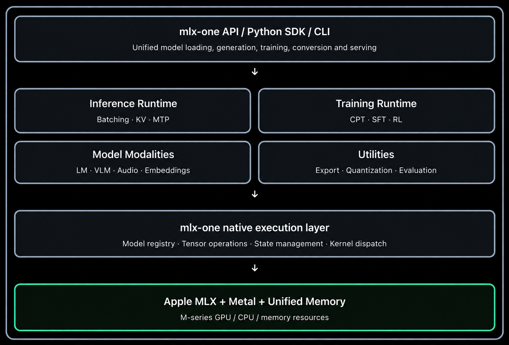
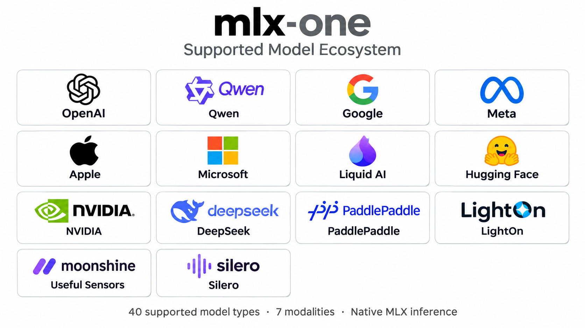
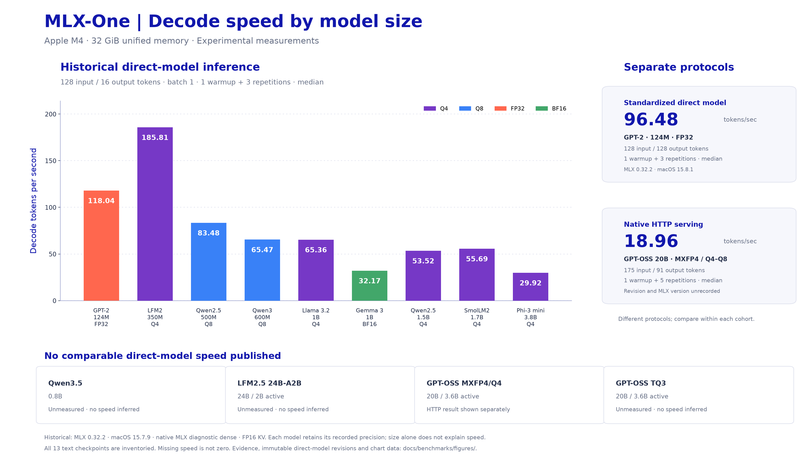
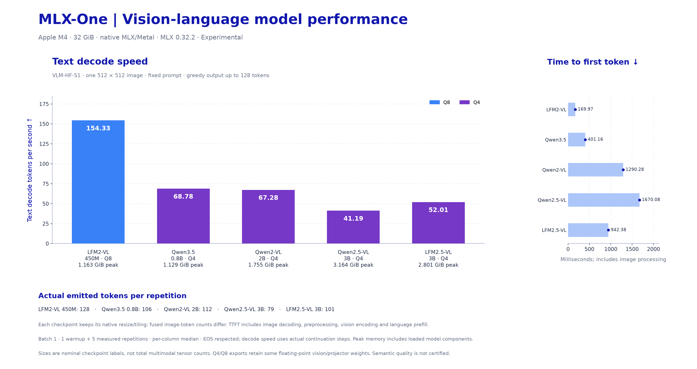
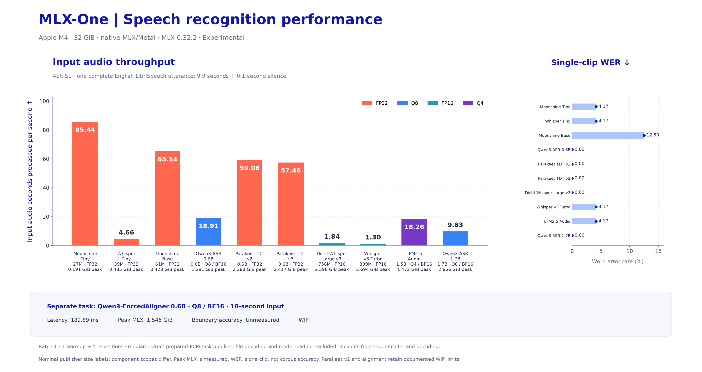
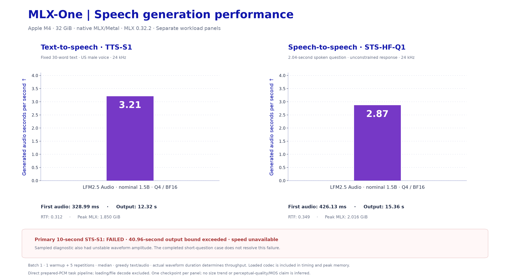
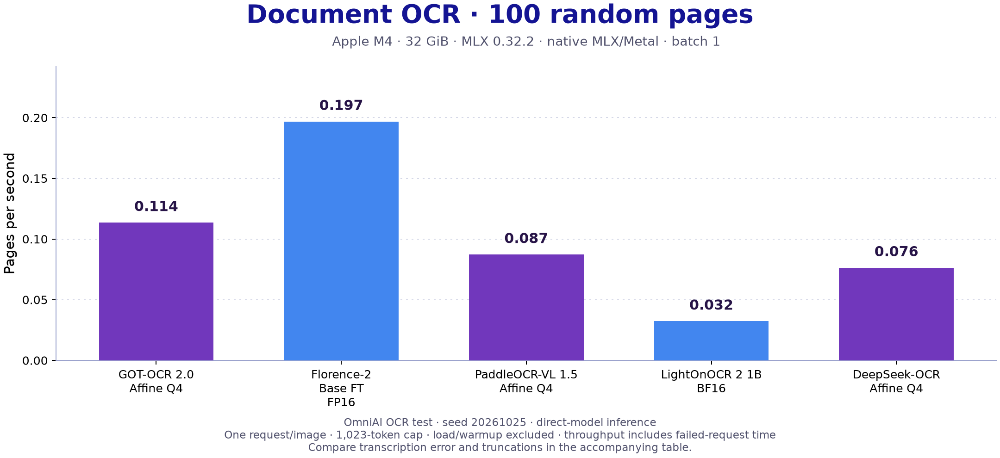
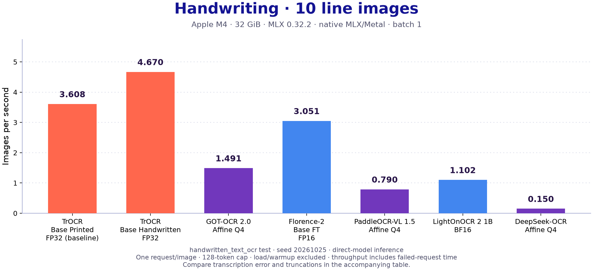
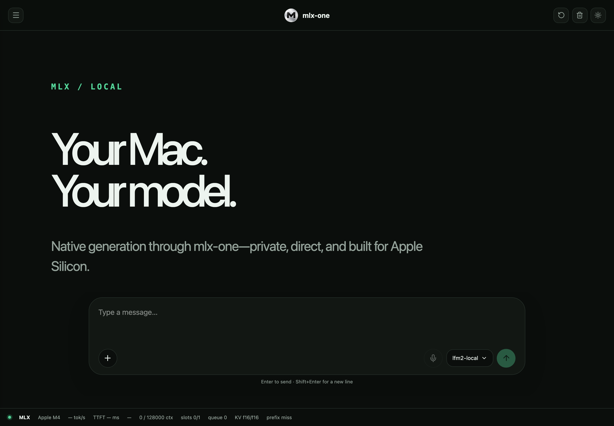

<p align="center">
  
</p>

<h1 align="center">mlx-one</h1>

<p align="center"><strong>One stack. Native MLX. Built for Apple Silicon.</strong></p>

<p align="center">
  A unified, native MLX stack for language, vision-language, embeddings,
  audio-language, speech, segmentation and classification models on Apple Silicon.
</p>

<p align="center">
  <a href="https://www.python.org/"></a>
  <a href="https://github.com/SSusantAchary/mlx-one/blob/main/LICENSE"></a>
  
  <a href="https://pypi.org/project/mlx-one/0.1.4/"></a>
</p>

[**Quick Start**](#quick-start) | [**Performance**](#model-performance) · [VLM](#vision-language-model-performance) · [Audio](#audio-model-performance) · [OCR](#ocr-model-performance) | [**Models**](#supported-modalities-and-models) | [**Architecture**](#architecture) | [**APIs**](#python-cli-and-http-apis) | [**Documentation**](#documentation)

MLX-One is a native inference library built on Apple's MLX framework for Apple
Silicon. It brings text generation, vision-language inference, audio, OCR,
embeddings and segmentation into one extensible stack, with shared model
loading, execution and developer tooling.

## Why MLX-One?

- **Native model implementations:** model math, safe checkpoint loading,
  tokenization and generation live inside MLX-One.
- **One developer interface:** use Python, the CLI or HTTP for implemented tasks,
  with shared request lifecycle and evidence records.
- **Built for Apple Silicon:** MLX, Metal and unified memory underpin execution;
  memory planning helps choose bounded workloads for a device.
- **Extensible architectures:** configuration-driven registration and reusable
  components support language, vision, audio and retrieval families.
- **Optional acceleration:** MLXBoost provides an opt-in host-overhead optimization
  for eligible profiles, with explicit fallback and experimental status.

Hugging Face supplies configuration, tokenizer/processor assets and safe
`safetensors` checkpoints. Native inference runs through MLX-One and Apple MLX.

## Architecture

<p align="center">
  <a href="https://raw.githubusercontent.com/SSusantAchary/mlx-one/main/mlx-one_arch-visible-borders.png">
    
  </a>
</p>

Click the artwork for full resolution. It includes planned workflows such as
CPT and RL and broader MTP goals. Those labels do not establish implementation
or qualification; existing bounded Qwen3.5 MTP options have their own scope.
The optional MLXBoost module ships inside MLX-One.

The implemented native text path is:

```text
Python Engine / HTTP + SSE / CLI
                 ↓
Prepared prompt + identity + resolved execution plan
                 ↓
Reference execution or InferenceActor + BatchScheduler
                 ↓
Native model adapter → dense / paged / hybrid runner
                 ↓
CacheManager → ownership, prefix index, page arena, hybrid state
                 ↓
MLX + Metal + unified memory
```

The actor owns request state, sampling and cancellation. Cache reservations and
memory-pressure telemetry govern admission; matching evidence gates optimized
backend selection. Native model equations stay within family packages.

<a id="model-support-and-release"></a>

## Native Model Coverage

**45 native architecture types across seven modalities.** MLX-One supports
causal and encoder-decoder text generation, vision-language inference, speech,
OCR, dense and multi-representation retrieval, segmentation and classification.
**50 verified checkpoint profiles** cover these types, including ten additional
workflows that meet the technical release criteria for their documented tasks.
Checkpoint variants share architecture types; each support record identifies the
exact checkpoint, revision, precision, task and tested limits.

**Validation on Apple M4 / 32 GiB:** 2,599 tests and 9 subtests passed, with
95 optional tests skipped. A further 54 targeted checks passed after the final
interface and memory-accounting changes. Python 3.10–3.13 regression checks,
isolated-wheel installation and applicable Python, CLI, Engine and HTTP checks
passed. Native checkpoint execution used Python 3.12 and MLX/Metal 0.32.2.

[Checkpoint validation results](https://github.com/SSusantAchary/mlx-one/blob/main/docs/qualification/batch-1-sub-6b/results.json).

### Verified Checkpoint Workflows

The ten additional checkpoint profiles are listed below.

| Checkpoint | Task | Verified behavior |
| --- | --- | --- |
| `google-t5/t5-small` | Text-to-text generation | Native encoder-decoder, teacher-forced logits and bounded greedy translation |
| `google/vit-base-patch16-224` | Image classification | Fixed 224×224 RGB input, trained labels, matching class logits and top-five results |
| `hexgrad/Kokoro-82M` | Speech synthesis | Native 24 kHz English speech with `af_heart`; reviewed audio and native ASR round trip |
| `BAAI/bge-small-en-v1.5` | Dense retrieval | 384-D CLS embeddings with L2 normalization |
| `BAAI/bge-m3` | Multi-representation retrieval | Dense vectors, learned sparse weights, ColBERT token vectors and hybrid scoring |
| `sentence-transformers/paraphrase-multilingual-MiniLM-L12-v2` | Multilingual embeddings | 384-D masked mean vectors, preserving the publisher's unnormalized output; 128-token sentence limit |
| `nomic-ai/nomic-embed-text-v1.5` | Dense retrieval | Role prefixes, normalized 768-D default and explicit Matryoshka dimensions 64/128/256/512/768 |
| `intfloat/multilingual-e5-small` | Multilingual retrieval | 384-D masked mean plus L2 normalization, with `query:` / `passage:` prefixes |
| `cross-encoder/ms-marco-MiniLM-L6-v2` | Paired reranking | Trained BERT pooler and scalar head, raw relevance logits and separate sigmoid scores |
| `BAAI/bge-reranker-v2-m3` | Paired reranking | Native XLM-R classification head with source-logit and ranking checks |

These workflows have pinned real-checkpoint and interface evidence. ViT's
stricter hidden-state diagnostic remains failed; its supported scope is
supervised classification. Kokoro supports the verified English voice, up to
510 phonemes and 30 seconds per utterance. Full limits, conversion requirements
and retained diagnostics are in the linked validation results.

### Release Record

**0.1.2 was published on PyPI on 11 November 2026**, including the ten
additional workflows and all 45 architecture types in their documented scope.
Both uploaded artifacts match the validated wheel and source archive; see the
[release record](https://github.com/SSusantAchary/mlx-one/blob/main/docs/releases/0.1.2.json). The previous **0.1.1** release covers the original
40-type cohort. See the [0.1.1 release record](https://github.com/SSusantAchary/mlx-one/blob/main/docs/releases/0.1.1.json).

<p align="center">
  <a href="https://raw.githubusercontent.com/SSusantAchary/mlx-one/main/docs/assets/mlx-one-supported-model-ecosystem.png">
    
  </a>
</p>

The illustration shows the original 40-type release cohort. Current architecture
counts are listed in [Supported Modalities and Models](#supported-modalities-and-models).
Downloaded qualification weights were removed after recording results.

## Key Capabilities

| Capability | What is implemented |
| --- | --- |
| Text generation | Cached causal decoding, seeded sampling, stop sequences, streaming, chat templates and T5 encoder-decoder generation |
| Multimodal inference | Native image/text, speech, OCR and segmentation workflows within family-specific limits |
| Retrieval | Dense embeddings, role-aware queries, Matryoshka dimensions, learned sparse vectors, ColBERT and BERT/XLM-R/Qwen3 reranking |
| Speech synthesis | Native Kokoro acoustic and vocoder execution, optional English G2P and 24 kHz WAV output |
| Image classification | Supervised ViT class predictions and zero-shot CLIP workflows |
| Developer access | Context-managed Python engine, task CLI, local Web UI and HTTP/SSE serving |
| Inspection and planning | Safe artifact inspection, hardware profiles and workload memory estimates |
| Training and evaluation | Experimental LoRA/QLoRA SFT, dataset validation, adapter export and evidence tooling |

Task availability varies by checkpoint and interface.

## Version 0.1.4

**Published on PyPI on 15 November 2026.** This
release refreshes the chat workspace, adds serving progress/timing logs, fixes
GPT-OSS reasoning-only streams and recommends an 8192-token output budget with
low reasoning effort when context allows. Explicit user limits are preserved.
Native sampling and eligible GPT-OSS execution have bounded optimizations;
sustained long-response speed remains variable. Full 128K HTTP/tool workflows
are not qualified by these short-context measurements.

[GitHub releases](https://github.com/SSusantAchary/mlx-one/releases).

Install the published release:

```bash
python -m pip install --upgrade "mlx-one[server]==0.1.4"
mlx-one --version
```

## Quick Start

### Installation

Use Python 3.10+ on an Apple Silicon Mac running macOS 15+ for model execution.
MLX and MLX Metal are pinned to 0.32.2; Python 3.12.11 is the tested development
version. From a checkout of the current source, install the task dependencies:

```bash
python -m pip install -e '.[server,vision,kokoro]'
```

Install or upgrade to the published 0.1.4 release:

```bash
python -m pip install --upgrade "mlx-one==0.1.4"
```

For the HTTP server, vision and OCR dependencies:

```bash
python -m pip install --upgrade "mlx-one[server,vision,ocr,kokoro]==0.1.4"
mlx-one --version
```

Git installs use the selected revision; `mlx-one upgrade` upgrades from Git main.

### Load a text checkpoint and generate

The engine loads the model on entry and releases its resources on exit:

```python
from mlx_one import Engine

with Engine(model="openai-community/gpt2") as engine:
    result = engine.generate("The future of local AI is", max_tokens=64)
    print(result.text)
```

A local snapshot path also works. Use `revision` to pin an immutable checkpoint
and `offline=True` when all required assets are already cached.

### Run the CLI

```bash
mlx-one doctor
mlx-one generate openai-community/gpt2 "The future of local AI is" \
  --max-tokens 64 --temperature 0.8 --top-p 0.95 --seed 0
```

Add `--stream` for incremental text or `--offline` for cached/local assets.

### Run Task-Specific Models

```bash
mlx-one embed BAAI/bge-small-en-v1.5 'Paris is the capital of France.' --json-output

mlx-one rerank cross-encoder/ms-marco-MiniLM-L6-v2 'capital of France' \
  'Paris is the capital of France.' 'Bananas are yellow.' --json-output

mlx-one seq2seq google-t5/t5-small \
  'translate English to German: The house is wonderful.' --max-new-tokens 24

mlx-one classify-image google/vit-base-patch16-224 ./image.jpg --top-k 5 --json-output

mlx-one tts ./kokoro-native 'Hello, world.' --output ./speech.wav
```

Kokoro and BGE-M3 use safely converted local bundles.
The [retrieval and reranking example](https://github.com/SSusantAchary/mlx-one/blob/main/examples/batch1_retrieval.py) combines a
dense encoder with a paired scorer using MLX-One APIs. Use the recorded immutable
revisions when reproducing the validation results.

### Start the HTTP server

The source installation above includes the server dependencies:

```bash
mlx-one serve LiquidAI/LFM2-350M --inference-mode reference_dense \
  --host 127.0.0.1 --port 8888 --alias lfm2-local
```

Open `http://127.0.0.1:8888` for the bundled chat UI. The same process exposes
OpenAI-compatible endpoints at `/v1`.

<!-- model-performance-summary:start -->
## Model Performance

Historical **direct-model native MLX** measurements on Apple M4 / 32 GB, batch 1; 128 actual input / 16 actual output tokens, one warmup and three measured repetitions; per-column medians. Fresh FP16 KV, no prefix reuse; full-sequence logits.

MLX / Metal 0.32.2 / 0.32.2; macOS-15.7.9-arm64-arm-64bit; Python 3.12.11. TTFT includes prefill and first-token selection. Decode excludes that first token.

| Model | Precision | Hardware | TTFT (ms) | Prefill tok/s | Decode tok/s |
| --- | --- | --- | ---: | ---: | ---: |
| openai-community/gpt2 | FP32 | Apple M4 / 32 GB | 19.04 | 6722.29 | 118.04 |
| Qwen/Qwen2.5-0.5B-Instruct | Affine Q8 (group 64) | Apple M4 / 32 GB | 63.94 | 2001.96 | 83.48 |
| Qwen/Qwen3-0.6B | Affine Q8 (group 64) | Apple M4 / 32 GB | 100.39 | 1275.02 | 65.47 |
| LiquidAI/LFM2-350M | Affine Q4 (group 64) | Apple M4 / 32 GB | 40.24 | 3180.66 | 185.81 |
| HuggingFaceTB/SmolLM2-1.7B-Instruct | Affine Q4 (group 64) | Apple M4 / 32 GB | 333.28 | 384.06 | 55.69 |
| meta-llama/Llama-3.2-1B-Instruct | Affine Q4 (group 64) | Apple M4 / 32 GB | 341.58 | 374.73 | 65.36 |
| Qwen/Qwen2.5-1.5B-Instruct | Affine Q4 (group 64) | Apple M4 / 32 GB | 311.26 | 411.23 | 53.52 |
| google/gemma-3-1b-it | BF16 | Apple M4 / 32 GB | 189.47 | 675.56 | 32.17 |
| microsoft/Phi-3-mini-4k-instruct | Affine Q4 (group 64) | Apple M4 / 32 GB | 801.79 | 159.64 | 29.92 |

Affine Q4/Q8 use group size 64. These bounded experimental measurements are not release qualification, full-context validation or Python/HTTP throughput. Different model architectures and precisions affect comparison.



The chart labels the historical cohort and separate standardized GPT-2 result. Standardized 128/128 runs, HTTP serving, VLM, audio, and OCR use separate protocols.
<!-- model-performance-summary:end -->

### GPT-OSS native HTTP serving

Measured on Apple M4 with 32 GB unified memory, Python 3.12, using the native MLX-One server on 2026-10-23. One warmup followed by five sequential tool-call requests; 175 prompt tokens and 91 generated tokens per request. Throughput and TTFT are per-column medians; memory is the observed peak. This serving workload uses a separate protocol from the direct-model text table above.

| Model name | Parameters | Configured context (tokens) | Quantization/precision | Prefill tokens/sec | Decode tokens/sec | Native first-token time (ms) | Peak MLX memory (GiB) |
|---|---|---:|---|---:|---:|---:|---:|
| [mlx-community/gpt-oss-20b-MXFP4-Q4](https://github.com/SSusantAchary/mlx-one/blob/main/docs/validation/gpt-oss-kilo-2026-10-23.json) | 20B / 3.6B active | 131,072 | Mixed MXFP4 / affine Q4–Q8 | **75.95** | **18.96** | 2355.38 | 10.608 |

Native first-token time includes hidden analysis; the median first actionable tool delta arrived at **7.127 seconds**, after argument validation. The configured 131,072-token context was not tested at its full length. Standardized direct-model 128/128 coverage remains unchanged.

The historical serving report does not record an immutable local checkpoint revision or MLX version; it cannot qualify the current pinned GPT-OSS targets.


<!-- MLX-ONE-VLM-BENCHMARK-START -->
## Vision-Language Model Performance

Actual **direct-model native MLX/Metal** inference on pinned checkpoint revisions. These are image-inference measurements; Python Engine, CLI and HTTP serving overhead are separate. Functional and quality limits are recorded with the evidence.

**VLM-HF-S1 v1:** one 512 × 512 padded image from [Hugging Face documentation-images](https://huggingface.co/datasets/huggingface/documentation-images), with dataset revision and image hashes pinned in the [workload manifest](https://github.com/SSusantAchary/mlx-one/blob/main/benchmarks/vlm/hf-images.json). Batch 1, fixed prompt, greedy generation up to 128 emitted tokens; one warmup and five repetitions, per-column median. EOS is respected and actual output counts determine speed. Each checkpoint retains its own resize/tiling. TTFT includes image decoding/preprocessing; prefill combines vision encoding, projection and language prefill. “Vision processing” means image decoding/preprocessing only.

Q4/Q8 denote the published checkpoint format; vision or projector modules may retain floating-point weights.



[VLM size-versus-speed scatter plot](https://raw.githubusercontent.com/SSusantAchary/mlx-one/main/docs/benchmarks/figures/vlm-model-size-vs-decode.svg) · [VLM chart SVG](https://raw.githubusercontent.com/SSusantAchary/mlx-one/main/docs/benchmarks/figures/vlm-model-performance.svg)

**Measured hardware:** Apple M4, 32 GiB; macOS-15.8.1-arm64-arm-64bit; MLX 0.32.2; Python 3.12.11. Separate execution cohort.

| Model | Precision | Images | Vision processing (ms) | Prefill TPS | Decode TPS | TTFT (ms) | Peak MLX memory (GiB) | Scores |
|---|---|---:|---:|---:|---:|---:|---:|---|
| [Qwen2-VL 2B](https://github.com/SSusantAchary/mlx-one/blob/main/docs/benchmarks/vlm/results/V01-VLM-HF-S1.json) | Q4 | 1 | 6.05 | **279.68** | **67.28** | 1290.28 | 1.755 | [Scores](https://github.com/SSusantAchary/mlx-one/blob/main/docs/benchmarks/vlm/results/V01-VLM-HF-S1.json) |
| [Qwen2.5-VL 3B](https://github.com/SSusantAchary/mlx-one/blob/main/docs/benchmarks/vlm/results/V02-VLM-HF-S1.json) | Q4 | 1 | 6.05 | **215.86** | **41.19** | 1670.08 | 3.164 | [Scores](https://github.com/SSusantAchary/mlx-one/blob/main/docs/benchmarks/vlm/results/V02-VLM-HF-S1.json) |
| [Qwen3.5 0.8B](https://github.com/SSusantAchary/mlx-one/blob/main/docs/benchmarks/vlm/results/V03-VLM-HF-S1.json) | Q4 | 1 | 4.81 | **717.75** | **68.78** | 401.16 | 1.129 | [Scores](https://github.com/SSusantAchary/mlx-one/blob/main/docs/benchmarks/vlm/results/V03-VLM-HF-S1.json) |
| [LFM2-VL 450M](https://github.com/SSusantAchary/mlx-one/blob/main/docs/benchmarks/vlm/results/V04-VLM-HF-S1.json) | Q8 | 1 | 7.16 | **1739.05** | **154.33** | 169.97 | 1.163 | [Scores](https://github.com/SSusantAchary/mlx-one/blob/main/docs/benchmarks/vlm/results/V04-VLM-HF-S1.json) |
| [LFM2.5-VL 3B](https://github.com/SSusantAchary/mlx-one/blob/main/docs/benchmarks/vlm/results/V05-VLM-HF-S1.json) | Q4 | 1 | 7.37 | **300.73** | **52.01** | 942.38 | 2.801 | [Scores](https://github.com/SSusantAchary/mlx-one/blob/main/docs/benchmarks/vlm/results/V05-VLM-HF-S1.json) |

**Actual fused input / emitted output tokens per repetition:** Qwen2-VL 2B: 359 / 112; Qwen2.5-VL 3B: 359 / 79; Qwen3.5 0.8B: 284 / 106; LFM2-VL 450M: 282 / 128; LFM2.5-VL 3B: 281 / 101.


High-resolution (1024 × 1024), four-image and OCR workloads remain separate. The HF image protocol is not pooled with the earlier synthetic-image protocol. See the [pinned checkpoint inventory](https://github.com/SSusantAchary/mlx-one/blob/main/docs/benchmarks/vlm/benchmark_plan.json). Text-model measurements use different protocols.
<!-- MLX-ONE-VLM-BENCHMARK-END -->


<!-- MLX-ONE-AUDIO-BENCHMARK-START -->
## Audio Model Performance

Historical native audio performance. Values below are validated measurements; “—” means unavailable. Recognition uses one pinned English LibriSpeech utterance (9.9 seconds, padded to 10); its WER is a single-clip check, not corpus accuracy. See the linked raw evidence.

Protocol: batch 1, one warmup, five repetitions, median; actual audio durations. ASR uses a fixed 10-second clip (ASR-S1); TTS uses fixed 30-word text (TTS-S1). RTF is processing seconds divided by input audio seconds for ASR, or generated audio seconds for synthesis. Lower RTF is faster. Hardware and MLX version are listed for each measured cohort. Direct-model, Python Engine and full file-pipeline runs remain separate.

### Speech Recognition Performance



[ASR size-versus-throughput scatter plot](https://raw.githubusercontent.com/SSusantAchary/mlx-one/main/docs/benchmarks/figures/audio-model-size-vs-asr.svg) · [ASR chart SVG](https://raw.githubusercontent.com/SSusantAchary/mlx-one/main/docs/benchmarks/figures/audio-asr-performance.svg)

| Model | Precision | Audio (s) | Latency (ms) | RTF ↓ | Audio sec/sec ↑ | WER (%) | Peak MLX (GiB) | Scores |
| --- | --- | --- | --- | --- | --- | --- | --- | --- |
| [Whisper Tiny](https://github.com/SSusantAchary/mlx-one/blob/main/docs/benchmarks/audio/results/hf-2026-10-24/A01-ASR-S1.json) | FP32 | 10.000 | 2144.869 | 0.214 | **4.662** | 4.167 | 0.485 | [Scores](https://github.com/SSusantAchary/mlx-one/blob/main/docs/benchmarks/audio/results/hf-2026-10-24/A01-ASR-S1.json) |
| [Whisper Large v3 Turbo](https://github.com/SSusantAchary/mlx-one/blob/main/docs/benchmarks/audio/results/hf-2026-10-24/A02-ASR-S1.json) | FP16 | 10.000 | 7666.962 | 0.767 | **1.304** | 4.167 | 2.694 | [Scores](https://github.com/SSusantAchary/mlx-one/blob/main/docs/benchmarks/audio/results/hf-2026-10-24/A02-ASR-S1.json) |
| [Distil-Whisper Large v3](https://github.com/SSusantAchary/mlx-one/blob/main/docs/benchmarks/audio/results/hf-2026-10-24/A03-ASR-S1.json) | FP16 | 10.000 | 5433.400 | 0.543 | **1.840** | 0.000 | 2.596 | [Scores](https://github.com/SSusantAchary/mlx-one/blob/main/docs/benchmarks/audio/results/hf-2026-10-24/A03-ASR-S1.json) |
| [Moonshine Tiny](https://github.com/SSusantAchary/mlx-one/blob/main/docs/benchmarks/audio/results/hf-2026-10-24/A04-ASR-S1.json) | FP32 | 10.000 | 117.038 | 0.012 | **85.443** | 4.167 | 0.191 | [Scores](https://github.com/SSusantAchary/mlx-one/blob/main/docs/benchmarks/audio/results/hf-2026-10-24/A04-ASR-S1.json) |
| [Moonshine Base](https://github.com/SSusantAchary/mlx-one/blob/main/docs/benchmarks/audio/results/hf-2026-10-24/A05-ASR-S1.json) | FP32 | 10.000 | 153.511 | 0.015 | **65.142** | 12.500 | 0.423 | [Scores](https://github.com/SSusantAchary/mlx-one/blob/main/docs/benchmarks/audio/results/hf-2026-10-24/A05-ASR-S1.json) |
| [Qwen3-ASR 0.6B](https://github.com/SSusantAchary/mlx-one/blob/main/docs/benchmarks/audio/results/hf-2026-10-24/A06-ASR-S1.json) | Q8 / BF16 | 10.000 | 528.726 | 0.053 | **18.913** | 0.000 | 1.281 | [Scores](https://github.com/SSusantAchary/mlx-one/blob/main/docs/benchmarks/audio/results/hf-2026-10-24/A06-ASR-S1.json) |
| [Qwen3-ASR 1.7B](https://github.com/SSusantAchary/mlx-one/blob/main/docs/benchmarks/audio/results/hf-2026-10-24/A07-ASR-S1.json) | Q8 / BF16 | 10.000 | 1017.307 | 0.102 | **9.830** | 0.000 | 2.656 | [Scores](https://github.com/SSusantAchary/mlx-one/blob/main/docs/benchmarks/audio/results/hf-2026-10-24/A07-ASR-S1.json) |
| [Parakeet TDT v2](https://github.com/SSusantAchary/mlx-one/blob/main/docs/benchmarks/audio/results/hf-2026-10-24/A08-ASR-S1.json) | FP32 | 10.000 | 169.265 | 0.017 | **59.079** | 0.000 | 2.383 | [Scores](https://github.com/SSusantAchary/mlx-one/blob/main/docs/benchmarks/audio/results/hf-2026-10-24/A08-ASR-S1.json) |
| [Parakeet TDT v3](https://github.com/SSusantAchary/mlx-one/blob/main/docs/benchmarks/audio/results/hf-2026-10-24/A09-ASR-S1.json) | FP32 | 10.000 | 174.019 | 0.017 | **57.465** | 0.000 | 2.417 | [Scores](https://github.com/SSusantAchary/mlx-one/blob/main/docs/benchmarks/audio/results/hf-2026-10-24/A09-ASR-S1.json) |
| [LFM2.5 Audio 1.5B](https://github.com/SSusantAchary/mlx-one/blob/main/docs/benchmarks/audio/results/hf-2026-10-24/A10-ASR-S1.json) | Q4 / BF16 | 10.000 | 547.659 | 0.055 | **18.260** | 4.167 | 1.472 | [Scores](https://github.com/SSusantAchary/mlx-one/blob/main/docs/benchmarks/audio/results/hf-2026-10-24/A10-ASR-S1.json) |

Measured on Apple M4, 32 GiB; MLX 0.32.2; native MLX/Metal; direct-model-prepared-pcm; ASR-S1.

### Forced Alignment Performance

| Model | Precision | Audio (s) | Latency (ms) | Mean boundary error (ms) | Peak MLX (GiB) | Scores |
| --- | --- | --- | --- | --- | --- | --- |
| [Qwen3-ForcedAligner 0.6B](https://github.com/SSusantAchary/mlx-one/blob/main/docs/benchmarks/audio/results/hf-2026-10-24/A11-ALIGN-S1.json) | Q8 / BF16 | 10.000 | 189.892 | — | 1.546 | [Scores](https://github.com/SSusantAchary/mlx-one/blob/main/docs/benchmarks/audio/results/hf-2026-10-24/A11-ALIGN-S1.json) |

Measured on Apple M4, 32 GiB; MLX 0.32.2; native MLX/Metal; direct-model-prepared-pcm; ALIGN-S1.

### Speech Generation Performance



[Speech generation chart SVG](https://raw.githubusercontent.com/SSusantAchary/mlx-one/main/docs/benchmarks/figures/audio-speech-generation.svg). Speech quality and alignment accuracy retain their documented limits.

| Model | Precision | Task | First audio (ms) | Output (s) | RTF ↓ | Audio sec/sec ↑ | Peak MLX (GiB) | Scores |
| --- | --- | --- | --- | --- | --- | --- | --- | --- |
| [LFM2.5 Audio 1.5B](https://github.com/SSusantAchary/mlx-one/blob/main/docs/benchmarks/audio/results/hf-2026-10-24/A12-TTS-S1.json) | Q4 / BF16 | synthesize | 328.986 | 12.320 | 0.312 | **3.207** | 1.850 | [Scores](https://github.com/SSusantAchary/mlx-one/blob/main/docs/benchmarks/audio/results/hf-2026-10-24/A12-TTS-S1.json) |
| [LFM2.5 Audio 1.5B](https://github.com/SSusantAchary/mlx-one/blob/main/docs/benchmarks/audio/results/hf-2026-10-24/A13-STS-S1.json) | Q4 / BF16 | speech-to-speech | — | — | — | — | — | [Failed; WIP](https://github.com/SSusantAchary/mlx-one/blob/main/docs/benchmarks/audio/results/hf-2026-10-24/A13-STS-S1.json) |

Measured on Apple M4, 32 GiB; MLX 0.32.2; native MLX/Metal; direct-model-prepared-pcm; TTS-S1.

### Speech-to-speech: separate short-question workload

**STS-HF-Q1:** a different 2.04-second spoken question from the same pinned dataset, without padding; greedy generation, one warmup, five repetitions, median. This completed case does not replace the failed 10-second STS-S1 run.

| Model | First audio (ms) | Output (s) | RTF ↓ | Audio sec/sec ↑ | Peak MLX (GiB) |
| --- | ---: | ---: | ---: | ---: | ---: |
| [LFM2.5 Audio 1.5B Q4](https://github.com/SSusantAchary/mlx-one/blob/main/docs/benchmarks/audio/results/hf-2026-10-24/A13-STS-HF-Q1-direct-model-prepared-pcm.json) | 426.127 | 15.360 | 0.349 | **2.867** | 2.016 |

Apple M4, 32 GiB; MLX 0.32.2; native MLX/Metal; direct-model-prepared-pcm. Experimental; speech quality requires listening review.

Independent alignment boundary accuracy was not measured in this historical cohort; newer TIMIT timing checks used a separate workload. Q4 LFM speech-to-speech exceeded its output bound on this fixture; its sampled diagnostic also had unstable waveform amplitude. No speed is published for that failed task. TTS timings do not establish perceptual quality. Qwen ASR streaming reprocesses a bounded accumulated utterance; it is not a causal streaming encoder.

<!-- MLX-ONE-AUDIO-BENCHMARK-END -->


<!-- MLX-ONE-OCR-BENCHMARK-START -->
## OCR Model Performance

Experimental native OCR on **100 randomly selected document images** from [OmniAI OCR Benchmark](https://huggingface.co/datasets/getomni-ai/ocr-benchmark). All page models use the same pinned sample (seed 20261025).

**Apple M4, 32 GiB unified memory · MLX 0.32.2 · direct-model inference · native MLX/Metal · batch 1.** One 16-token warmup, then one timed request per image; image-dependent input lengths and a 1,023-token output cap, greedy decoding. Actual token counts are retained in JSON. Latency is the median of completed requests; pages/s is completed pages divided by total inference time, including failed requests. Peak memory is the maximum observed MLX allocation, including weights.



| Model | Precision | Completed | Median latency (s) | Pages/s | Markdown-ref. CER ↓ | Peak MLX (GiB) | Truncated |
|---|---|---:|---:|---:|---:|---:|---:|
| [TrOCR Base Printed](https://github.com/SSusantAchary/mlx-one/blob/main/docs/benchmarks/ocr/omni100-20261025/O01.json) | FP32 | [Line crops required](https://github.com/SSusantAchary/mlx-one/blob/main/docs/benchmarks/ocr/omni100-20261025/O01.json) | — | — | — | — | — |
| [TrOCR Base Handwritten](https://github.com/SSusantAchary/mlx-one/blob/main/docs/benchmarks/ocr/omni100-20261025/O02.json) | FP32 | [Line crops required](https://github.com/SSusantAchary/mlx-one/blob/main/docs/benchmarks/ocr/omni100-20261025/O02.json) | — | — | — | — | — |
| [GOT-OCR 2.0](https://github.com/SSusantAchary/mlx-one/blob/main/docs/benchmarks/ocr/omni100-20261025/O03.json) | Affine Q4 | [97/100](https://github.com/SSusantAchary/mlx-one/blob/main/docs/benchmarks/ocr/omni100-20261025/O03.json) | 12.42 | **0.114** | 74.5% | 1.673 | 56 |
| [Florence-2 Base FT](https://github.com/SSusantAchary/mlx-one/blob/main/docs/benchmarks/ocr/omni100-20261025/O04.json) | FP16 | [97/100](https://github.com/SSusantAchary/mlx-one/blob/main/docs/benchmarks/ocr/omni100-20261025/O04.json) | 6.60 | **0.197** | 78.3% | 1.201 | 61 |
| [PaddleOCR-VL 1.5](https://github.com/SSusantAchary/mlx-one/blob/main/docs/benchmarks/ocr/omni100-20261025/O05.json) | Affine Q4 | [97/100](https://github.com/SSusantAchary/mlx-one/blob/main/docs/benchmarks/ocr/omni100-20261025/O05.json) | 13.87 | **0.087** | 59.8% | 1.560 | 53 |
| [LightOnOCR 2 1B](https://github.com/SSusantAchary/mlx-one/blob/main/docs/benchmarks/ocr/omni100-20261025/O06.json) | BF16 | [97/100](https://github.com/SSusantAchary/mlx-one/blob/main/docs/benchmarks/ocr/omni100-20261025/O06.json) | 31.53 | **0.032** | 67.7% | 8.661 | 64 |
| [DeepSeek-OCR](https://github.com/SSusantAchary/mlx-one/blob/main/docs/benchmarks/ocr/omni100-20261025/O07.json) | Affine Q4 | [97/100](https://github.com/SSusantAchary/mlx-one/blob/main/docs/benchmarks/ocr/omni100-20261025/O07.json) | 13.59 | **0.076** | 51.2% | 3.810 | 41 |

CER uses NFKC and whitespace normalization against Markdown references; formatting and reading order affect this score, which can exceed 100%. Failed requests count as empty predictions. This is an MLX-One corpus test, separate from OmniAI’s official leaderboard and the synthetic OCR-S* protocol.

TrOCR requires annotated line crops, absent from this page dataset. PaddleOCR-VL uses direct page transcription; its separate layout pipeline is not included. No layout accuracy or JSON extraction score is claimed by this page test.


### Handwriting: 10 line images

The same seeded sample of 10 test-split images from [handwritten_text_ocr](https://huggingface.co/datasets/toghrultahirov/handwritten_text_ocr). One 16-token warmup; one request per image; image-dependent input lengths; 128-token output cap. Micro CER/WER use the supplied plain-text references after NFKC and whitespace normalization; failed requests count as empty outputs.

**Apple M4, 32 GiB · MLX 0.32.2 · native MLX/Metal · direct-model inference · batch 1.**



| Model | Precision | Completed | Median latency (s) | Images/s | CER ↓ | WER ↓ | Peak MLX (GiB) | Truncated |
|---|---|---:|---:|---:|---:|---:|---:|---:|
| [TrOCR Base Printed (printed baseline)](https://github.com/SSusantAchary/mlx-one/blob/main/docs/benchmarks/ocr/hand10-20261025/O01.json) | FP32 | [10/10](https://github.com/SSusantAchary/mlx-one/blob/main/docs/benchmarks/ocr/hand10-20261025/O01.json) | 0.27 | **3.608** | 80.6% | 100.0% | 1.488 | 0 |
| [TrOCR Base Handwritten](https://github.com/SSusantAchary/mlx-one/blob/main/docs/benchmarks/ocr/hand10-20261025/O02.json) | FP32 | [10/10](https://github.com/SSusantAchary/mlx-one/blob/main/docs/benchmarks/ocr/hand10-20261025/O02.json) | 0.21 | **4.670** | 4.4% | 10.6% | 1.488 | 0 |
| [GOT-OCR 2.0](https://github.com/SSusantAchary/mlx-one/blob/main/docs/benchmarks/ocr/hand10-20261025/O03.json) | Affine Q4 | [10/10](https://github.com/SSusantAchary/mlx-one/blob/main/docs/benchmarks/ocr/hand10-20261025/O03.json) | 0.67 | **1.491** | 40.6% | 94.7% | 1.673 | 0 |
| [Florence-2 Base FT](https://github.com/SSusantAchary/mlx-one/blob/main/docs/benchmarks/ocr/hand10-20261025/O04.json) | FP16 | [10/10](https://github.com/SSusantAchary/mlx-one/blob/main/docs/benchmarks/ocr/hand10-20261025/O04.json) | 0.30 | **3.051** | 97.9% | 143.6% | 1.201 | 1 |
| [PaddleOCR-VL 1.5](https://github.com/SSusantAchary/mlx-one/blob/main/docs/benchmarks/ocr/hand10-20261025/O05.json) | Affine Q4 | [10/10](https://github.com/SSusantAchary/mlx-one/blob/main/docs/benchmarks/ocr/hand10-20261025/O05.json) | 1.13 | **0.790** | 13.8% | 43.6% | 1.540 | 0 |
| [LightOnOCR 2 1B](https://github.com/SSusantAchary/mlx-one/blob/main/docs/benchmarks/ocr/hand10-20261025/O06.json) | BF16 | [10/10](https://github.com/SSusantAchary/mlx-one/blob/main/docs/benchmarks/ocr/hand10-20261025/O06.json) | 0.98 | **1.102** | 6.9% | 33.0% | 2.766 | 0 |
| [DeepSeek-OCR](https://github.com/SSusantAchary/mlx-one/blob/main/docs/benchmarks/ocr/hand10-20261025/O07.json) | Affine Q4 | [10/10](https://github.com/SSusantAchary/mlx-one/blob/main/docs/benchmarks/ocr/hand10-20261025/O07.json) | 6.68 | **0.150** | 24.7% | 48.9% | 3.810 | 0 |

TrOCR Printed is an out-of-domain baseline. Page models process the same cropped lines in their OCR mode; this small sample is not a general handwriting qualification. Handwriting timings are separate from the 100-page workload.

<!-- MLX-ONE-OCR-BENCHMARK-END -->


## Additional Modality Performance

**Native task latency (2026-11-03) — Apple M4 / 32 GiB, macOS 15.8.1, Python 3.12.11,
MLX 0.32.2, FP32.** One process, one excluded warmup, 20 timed Python task
calls per row; model loading excluded. Timing includes preparation and
synchronized execution. Workloads are distinct; these are not HTTP or
concurrent-serving rates. p95 uses the nearest-rank method.

| Task | Workload | Median (ms) | p95 (ms) |
| --- | --- | ---: | ---: |
| DistilBERT SST-2 | One text | 14.95 | 17.58 |
| BERT NER | One text, SIMPLE aggregation | 18.90 | 26.14 |
| CLIP ViT-B/32 | One image, two labels | 80.19 | 89.68 |
| Silero VAD | One second of decoded mono 16 kHz audio | 16.35 | 22.97 |

### Retrieval and Segmentation

| Modality | Available performance evidence | Remaining measurement gap |
| --- | --- | --- |
| Embeddings and reranking | Measured FP32 dense retrieval and paired reranking pipelines on M4 | Timings depend on input lengths and batching |
| SAM3 segmentation and tracking | Approximately 8.41 GB peak MLX allocation in controlled 32-frame single-object comparisons on M4 / 32 GB | Isolated latency and throughput were outside the fixture scope |


## Supported Modalities and Models

| Modality | Native architecture types | Primary capabilities |
| --- | ---: | --- |
| Text generation | 12 | Native completion/chat and T5 text-to-text generation |
| Vision-language | 4 | Single-image/text inference for Qwen2-VL, Qwen2.5-VL, Qwen3.5 and LFM2-VL |
| Audio & speech | 8 | ASR, alignment, VAD, LFM speech and Kokoro synthesis |
| OCR & documents | 6 | TrOCR line recognition and page text recognition |
| Embeddings & reranking | 7 | Dense, paired reranking, sparse and ColBERT retrieval |
| Segmentation | 4 | SAM3 image prompts and native offline/streaming video workflows |
| Classification | 4 | Sentiment, NER, zero-shot images and supervised ViT |
| **Total** | **45** | Checkpoint-specific primary workflows across seven modalities |

Support applies to the checkpoint, precision and operations recorded in the
[0.1.1 catalog](https://github.com/SSusantAchary/mlx-one/blob/main/src/mlx_one/data/model_support_release_20261108.json) and
[additional checkpoint results](https://github.com/SSusantAchary/mlx-one/blob/main/docs/qualification/batch-1-sub-6b/results.json).

## Native Inference Engine and MLXBoost

`mlx_one.Engine` manages a native text model's lifecycle, synchronous generation,
streaming, asynchronous submission, cooperative cancellation and cleanup. The
existing `generate()` and `stream_generate()` functions remain available.

Dense reference execution is the default, with one active sequence. Block,
paged, dense-batch and hybrid-batch paths have explicit capability and evidence
requirements; source implementation does not establish production qualification.

MLXBoost ships inside `mlx-one` and requires explicit `mlxboost_b1` opt-in;
feature flags default off. `fast_decode` reduces eligible host overhead. The
GPT-OSS MXFP4/Q4 recipe uses pinned expert dispatch, compiled activation and
bounded prefill, selected with `MLXBoostConfig(gptoss_mlx_lm=True)` or
`--mlxboost-gptoss-mlx-lm`. Unsupported configurations retain explicit fallback
or strict errors. Optimizations remain profile-specific and experimental.

The 0.1.4 maintenance changes add native sampling improvements and conservative
full-history decode attention. Sustained long responses still slow down.

### MLX-Boost Performance Scorecard — experimental

Recorded achievements include the accepted Phase 0 native bridge and offline
tooling, implemented Q4/Q8 GEMV kernels, and a correctness-tested MoE combine
prototype. These implementation milestones do not establish model acceleration.

Implementation success and performance qualification are separate. Saved
measurements on **Apple M4 / 32 GiB, MLX/Metal 0.32.2** show:

| Implementation | Verified measurement | Status |
| --- | --- | --- |
| Phase 0 AXPBY and F01–F04 infrastructure | 123 acceptance tests; 180 numerical cases with zero error. FP16 `[4096]`: stock/native **262.0000/226.3125 µs** and **258.8125/224.1035 µs** in two runs | Foundation accepted; demo remains experimental |
| G03 affine Q4 GEMV | FP16/group 64, K×N=2048×2048: stock **61.845 µs**, native **134.120 µs** (**0.4611×**) | **UNQUALIFIED** |
| G03 affine Q8 GEMV | FP16/group 64, K×N=896×896: stock **22.047 µs**, native **29.389 µs** (**0.7502×**) | **UNQUALIFIED** |
| Fused MoE combine prototype | 17 focused tests pass; FP16 `[1,4,2048]`: stock **0.536458 ms**, native **0.540542 ms**; no speed win | Operator rejected; model blocked |

Latencies are synchronized wall time. AXPBY uses 50 warm samples/backend per
run; GEMV uses 50 windows of 16 calls, divided per call; MoE uses three paired
trials. These protocols are separate. The MoE operator's extra peak allocation
fell from **20,480 to 4,100 bytes**; no model-memory improvement was measured.
G03's measured forced-native model decode was slower. These entries establish
**no model acceleration**; default-off fallback and correctness gates remain.
See the [machine-readable MLXBoost scorecard](https://github.com/SSusantAchary/mlx-one/blob/main/docs/experimental/mlxboost-performance-scorecard.json).

## Python, CLI and HTTP APIs

Stream text through the Python engine:

```python
from mlx_one import Engine

with Engine(model="LiquidAI/LFM2-350M") as engine:
    for chunk in engine.stream("Name two advantages of MLX.", max_tokens=64):
        print(chunk.text, end="", flush=True)
```

Inspect a model without loading weights, or transcribe a local recording:

```bash
mlx-one inspect Qwen/Qwen2.5-1.5B
mlx-one transcribe openai/whisper-tiny recording.wav --language en
```

Audio files require FFmpeg. Send a chat request to the server started above:

```bash
curl http://127.0.0.1:8888/v1/chat/completions \
  -H 'Content-Type: application/json' \
  -d '{"model":"lfm2-local","messages":[{"role":"user","content":"Explain MLX briefly."}],"max_tokens":64}'
```

<p align="center">
  <a href="https://raw.githubusercontent.com/SSusantAchary/mlx-one/main/mlx_One_chat_ui.png">
    
  </a>
</p>

Earlier native chat UI connected to a local model. The 0.1.4 workspace adds
session tabs, history and message actions.

Task-specific HTTP routes use the same server authentication and model lifecycle:

| Task | Endpoint |
| --- | --- |
| Dense embeddings | `/v1/embeddings` |
| Paired reranking | `/v1/rerank` |
| T5 text-to-text generation | `/v1/tasks/text-to-text-generation` |
| Supervised ViT classification | `/v1/tasks/image-classification` |
| Kokoro speech generation | `/v1/tasks/speech-generation` |

Serve a complete local task bundle with `mlx-one serve ./bundle --alias local`.

## Documentation

- [Quick Start](#quick-start) for setup, examples, and server commands.
- [Supported Modalities and Models](#supported-modalities-and-models) for checkpoint scope.
- [Python, CLI and HTTP APIs](#python-cli-and-http-apis) for request examples.
- [GitHub releases](https://github.com/SSusantAchary/mlx-one/releases) for release history.

## Citation

If you use MLX-One in your work, please cite it as:

```bibtex
@software{mlx_one2026,
author = {Achary, S. Susant},
title  = {mlx-one: Unified Native MLX Stack for Apple Silicon},
year   = {2026},
url    = {https://github.com/SSusantAchary/mlx-one},
note   = {Version 0.1.4. Native GPU-accelerated machine learning workflows on Apple Silicon}
}
```

See [CITATION.bib](https://github.com/SSusantAchary/mlx-one/blob/main/CITATION.bib) for the repository citation file.

## License

MLX-One is released under the [Apache License 2.0](https://github.com/SSusantAchary/mlx-one/blob/main/LICENSE).
Model checkpoints retain their separate terms.
