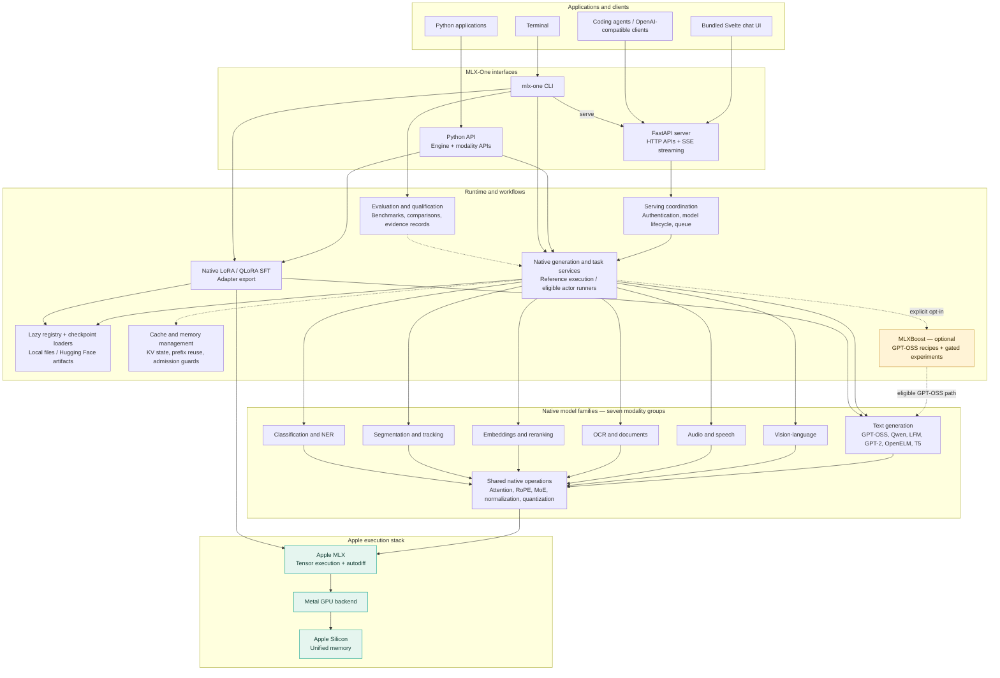

# Current MLX-One architecture

This diagram describes the local `release/v0.1.4` candidate, including the
GPT-OSS serving and UI changes prepared for maintainer publication. Arrows show calls or execution
dependencies. Dashed arrows show optional execution or shared services.

Each modality has task-specific preprocessing, loading and output handling;
they do not all execute through the public text `Engine`. The runtime node
groups the text engine, server generation engine and native task services.

Cache layouts, batching, prefix reuse and acceleration require matching model
capabilities and settings. MLXBoost ships inside MLX-One and requires explicit
opt-in. Experimental kernels are not automatically enabled or qualified across
all models. This diagram is an implementation map, not a release-support matrix
or a performance guarantee.

Primary source boundaries: `src/mlx_one/__init__.py`, `cli.py`, `server/`,
`engine/`, `models/`, `mlxboost/`, `training.py` and `ui/`.
