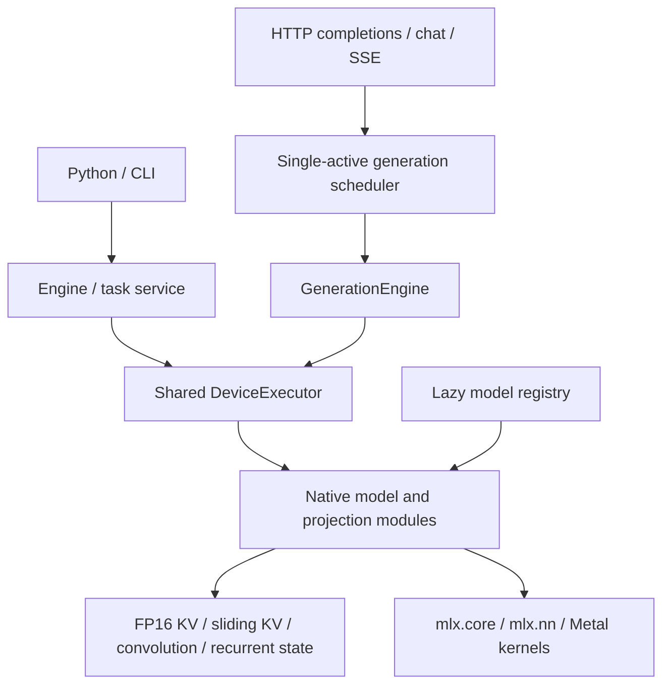

# MLX-One 0.1.0a1 native architecture

MLX-One executes native models through MLX core and MLX neural-network operations. Model metadata
is registered lazily without importing runtime implementations. The 30 architecture registrations
cover text and multimodal tasks; registration is separate from checkpoint support.

* `models/registry.py` and `core/registry.py` declare architecture/config/weight contracts.
* `text/loading.py` validates checkpoints, builds native models and materializes owned buffers.
* `engine/public.py`, `engine/device_executor.py` and cache management own public generation,
  device execution and request state. State storage and observed compute dtypes remain distinct.
* `server/model_manager.py`, `generation_engine.py`, `scheduler.py` and `app.py` provide model
  lifecycle, the existing single-active request queue, OpenAI-compatible routes and streaming.
* `models/language/gpt_oss/` supports biased sink attention, sliding/full KV, YaRN and top-four MoE.
  `quantization/turboquant/` executes packed TQ3 beside the separate MXFP4/affine implementations.
* Native audio, vision, embedding and retrieval implementations retain their existing APIs.
* `ui/src/` is the frontend source; `src/mlx_one/ui/dist/` is the packaged static application.

[Inference-engine overview and roadmap](inference-engine.md) distinguishes current components from
future optimizations. Advanced batching, paging, speculation and SSD paths remain experimental;
this cleanup does not promote them. [Current model admission](../model-admission.md) and the
[support matrix](../alpha_0_1/support-matrix.md) define checkpoint status. Historical numerical
research is optional and cannot silently become an ordinary release/admission gate.

Private prompts, implementation plans and machine receipts live under ignored `local/`.
[Archived evidence](../qualification/archived-evidence.md) explains preservation and reproduction.
