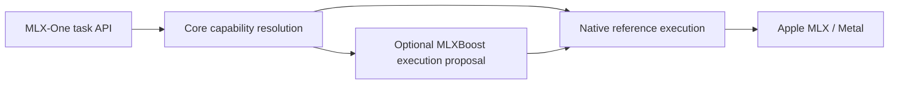

# MLXBoost module boundary

Status: **PROPOSED**. Date: 2026-11-04. This ADR describes ownership and a possible
future extraction. It changes no implementation, dependency, import or default.

MLXBoost is currently an independent optional execution module within MLX-One,
distributed as part of the same wheel. `reference_dense` remains the default.
The `mlxboost_b1` mode and `fast_decode` flag are explicit opt-ins. All feature
flags default to false; no automatic rollout is approved.

## Current ownership

| Owner | Responsibility |
|---|---|
| Native model modules | Equations, weight contracts, processors, state and checkpoint loading |
| MLX-One core | Registry, public APIs, request lifecycle, reference execution, capability resolution and fallback reporting |
| MLXBoost module and its core execution hooks | Optional execution configuration, eligibility and bounded host-overhead reduction |
| Apple MLX | Tensor execution, Metal backend and device allocation |

Current code is in `src/mlx_one/mlxboost/config.py`, with execution integration in
`src/mlx_one/engine/construction.py` and `src/mlx_one/engine/pressure.py`.
Configuration imports are backend-free but core does import the MLXBoost
configuration namespace. This ADR does not claim a presently lazy-loaded external
plugin, a separate dispatcher package, or custom Metal kernels.

The measured `fast_decode` path avoids calibration identity construction when
there is no activation-peak candidate. Live registry changes remain visible;
eligible calibration records retain the normal scope and evidence checks.
Model mathematics, cache ownership and numerical tolerances remain with core.

Eligibility checks currently cover family, dtype, quantization, dense backend,
one slot, disabled cache reuse, MLX 0.32.2 and Metal availability. The evidence
qualifies specific checkpoints separately; eligibility is not a checkpoint
qualification certificate. Unsupported features resolve to disabled configuration
with a fallback reason; `strict_reference=True` raises instead. The engine records
the requested and resolved mode. Strict mode itself is also default-off.

## Proposed stable boundary

The following flow is conceptual. It is an ownership proposal, not a shipped
external plugin interface:

A future optional adapter should receive a versioned execution description and
return its supported capability, evidence identity and fallback reason. Core
must remain usable with acceleration absent. Models and processors must not be
duplicated, replaced with foreign model runtimes, or moved into the accelerator.
Any external accelerator import would occur only after explicit selection and
capability resolution. This is a future requirement, not a statement about
today's configuration imports.

Model correctness, numerical parity and task quality remain independent gates.
The existing cached-vs-fresh model failures remain failed. A source-neutral
execution change can be evaluated independently under the current policy;
that policy does not turn a failed model gate into a pass. Current MLXBoost
status remains EXPERIMENTAL with rollout disabled. Published HTTP rates include
the entire response and cannot be presented as a model-forward improvement.

## Future distribution: proposal only

The name `mlx-one-boost` is reserved here as a proposal, not a released package
or an installation target. Extraction should require:

1. A small versioned interface stable across two MLX-One releases.
2. Repeatable checkpoint-specific benefit with unchanged numerical and task gates.
3. CI for core without the optional wheel, eligible opt-in paths and fallback.
4. An explicit MLX/core compatibility policy, release ownership and maintenance.
5. Reviewed source/model licensing, provenance and distribution responsibilities.

Until those conditions are met, keep the current internal module and existing
APIs. No package migration, dependency inversion, code movement or optimization
is part of this documentation change.

## Evidence

The [publication audit](../publication/2026-11-04/audit.md#mlxboost-evidence)
records raw-run selectors, hashes, request counts, measurement semantics and
known failures. The [README summary](../../README.md#native-inference-engine-and-mlxboost)
links to the measured off/on cohorts in the experimental report. Tests in `tests/mlxboost/` cover default
selection, opt-in eligibility, fallback and the calibration lookup boundary.
