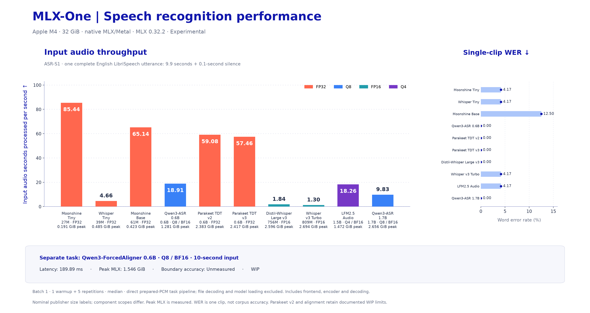
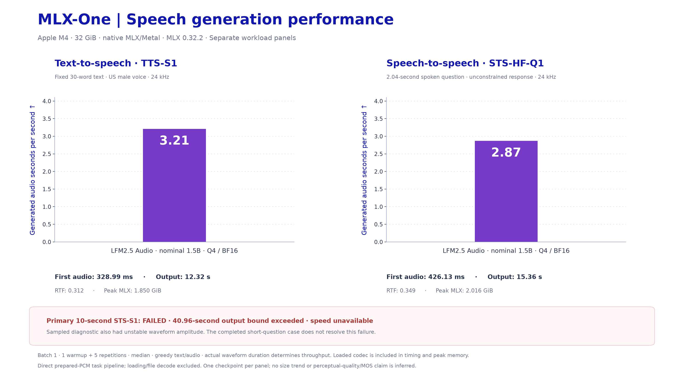

# Audio performance

[Benchmark navigation](../README.md) · [Generation ownership](../../documentation-generation.md)

<!-- MLX-ONE-AUDIO-BENCHMARK-START -->
## Audio Model Performance

Native audio support is experimental. Values below are validated measurements; “—” means unavailable. Recognition uses one pinned English LibriSpeech utterance (9.9 seconds, padded to 10); its WER is a single-clip check, not corpus accuracy. See the linked raw evidence.

Protocol: batch 1, one warmup, five repetitions, median; actual audio durations. ASR uses a fixed 10-second clip (ASR-S1); TTS uses fixed 30-word text (TTS-S1). RTF is processing seconds divided by input audio seconds for ASR, or generated audio seconds for synthesis. Lower RTF is faster. Hardware and MLX version are listed for each measured cohort. Direct-model, Python Engine and full file-pipeline runs remain separate.

### Speech Recognition Performance

[ASR size-versus-throughput scatter plot](../figures/audio-model-size-vs-asr.svg) · [ASR chart SVG](../figures/audio-asr-performance.svg)

| Model | Precision | Audio (s) | Latency (ms) | RTF ↓ | Audio sec/sec ↑ | WER (%) | Peak MLX (GiB) | Scores |
| --- | --- | --- | --- | --- | --- | --- | --- | --- |
| [Whisper Tiny](results/hf-2026-10-24/A01-ASR-S1.json) | FP32 | 10.000 | 2144.869 | 0.214 | **4.662** | 4.167 | 0.485 | [Scores](results/hf-2026-10-24/A01-ASR-S1.json) |
| [Whisper Large v3 Turbo](results/hf-2026-10-24/A02-ASR-S1.json) | FP16 | 10.000 | 7666.962 | 0.767 | **1.304** | 4.167 | 2.694 | [Scores](results/hf-2026-10-24/A02-ASR-S1.json) |
| [Distil-Whisper Large v3](results/hf-2026-10-24/A03-ASR-S1.json) | FP16 | 10.000 | 5433.400 | 0.543 | **1.840** | 0.000 | 2.596 | [Scores](results/hf-2026-10-24/A03-ASR-S1.json) |
| [Moonshine Tiny](results/hf-2026-10-24/A04-ASR-S1.json) | FP32 | 10.000 | 117.038 | 0.012 | **85.443** | 4.167 | 0.191 | [Scores](results/hf-2026-10-24/A04-ASR-S1.json) |
| [Moonshine Base](results/hf-2026-10-24/A05-ASR-S1.json) | FP32 | 10.000 | 153.511 | 0.015 | **65.142** | 12.500 | 0.423 | [Scores](results/hf-2026-10-24/A05-ASR-S1.json) |
| [Qwen3-ASR 0.6B](results/hf-2026-10-24/A06-ASR-S1.json) | Q8 / BF16 | 10.000 | 528.726 | 0.053 | **18.913** | 0.000 | 1.281 | [Scores](results/hf-2026-10-24/A06-ASR-S1.json) |
| [Qwen3-ASR 1.7B](results/hf-2026-10-24/A07-ASR-S1.json) | Q8 / BF16 | 10.000 | 1017.307 | 0.102 | **9.830** | 0.000 | 2.656 | [Scores](results/hf-2026-10-24/A07-ASR-S1.json) |
| [Parakeet TDT v2](results/hf-2026-10-24/A08-ASR-S1.json) | FP32 | 10.000 | 169.265 | 0.017 | **59.079** | 0.000 | 2.383 | [Scores](results/hf-2026-10-24/A08-ASR-S1.json) |
| [Parakeet TDT v3](results/hf-2026-10-24/A09-ASR-S1.json) | FP32 | 10.000 | 174.019 | 0.017 | **57.465** | 0.000 | 2.417 | [Scores](results/hf-2026-10-24/A09-ASR-S1.json) |
| [LFM2.5 Audio 1.5B](results/hf-2026-10-24/A10-ASR-S1.json) | Q4 / BF16 | 10.000 | 547.659 | 0.055 | **18.260** | 4.167 | 1.472 | [Scores](results/hf-2026-10-24/A10-ASR-S1.json) |

Measured on Apple M4, 32 GiB; MLX 0.32.2; native MLX/Metal; direct-model-prepared-pcm; ASR-S1.

### Forced Alignment Performance

| Model | Precision | Audio (s) | Latency (ms) | Mean boundary error (ms) | Peak MLX (GiB) | Scores |
| --- | --- | --- | --- | --- | --- | --- |
| [Qwen3-ForcedAligner 0.6B](results/hf-2026-10-24/A11-ALIGN-S1.json) | Q8 / BF16 | 10.000 | 189.892 | — | 1.546 | [Scores](results/hf-2026-10-24/A11-ALIGN-S1.json) |

Measured on Apple M4, 32 GiB; MLX 0.32.2; native MLX/Metal; direct-model-prepared-pcm; ALIGN-S1.

### Speech Generation Performance

[Speech generation chart SVG](../figures/audio-speech-generation.svg) · [Chart data and reproduction](../figures/README.md#vlm-and-audio-charts). Speech quality and alignment accuracy retain their documented limits.

| Model | Precision | Task | First audio (ms) | Output (s) | RTF ↓ | Audio sec/sec ↑ | Peak MLX (GiB) | Scores |
| --- | --- | --- | --- | --- | --- | --- | --- | --- |
| [LFM2.5 Audio 1.5B](results/hf-2026-10-24/A12-TTS-S1.json) | Q4 / BF16 | synthesize | 328.986 | 12.320 | 0.312 | **3.207** | 1.850 | [Scores](results/hf-2026-10-24/A12-TTS-S1.json) |
| [LFM2.5 Audio 1.5B](results/hf-2026-10-24/A13-STS-S1.json) | Q4 / BF16 | speech-to-speech | — | — | — | — | — | [Failed; WIP](results/hf-2026-10-24/A13-STS-S1.json) |

Measured on Apple M4, 32 GiB; MLX 0.32.2; native MLX/Metal; direct-model-prepared-pcm; TTS-S1.

### Speech-to-speech: separate short-question workload

**STS-HF-Q1:** a different 2.04-second spoken question from the same pinned dataset, without padding; greedy generation, one warmup, five repetitions, median. This completed case does not replace the failed 10-second STS-S1 run.

| Model | First audio (ms) | Output (s) | RTF ↓ | Audio sec/sec ↑ | Peak MLX (GiB) |
| --- | ---: | ---: | ---: | ---: | ---: |
| [LFM2.5 Audio 1.5B Q4](results/hf-2026-10-24/A13-STS-HF-Q1-direct-model-prepared-pcm.json) | 426.127 | 15.360 | 0.349 | **2.867** | 2.016 |

Apple M4, 32 GiB; MLX 0.32.2; native MLX/Metal; direct-model-prepared-pcm. Experimental; speech quality requires listening review.

Qwen alignment remains WIP because historical timestamp discrepancies are unresolved; boundary errors need independently annotated reference timings. LFM speech-to-speech exceeded its output bound on this fixture; its sampled diagnostic also had unstable waveform amplitude. No speed is published for that failed task. TTS timings do not establish perceptual quality. Qwen ASR streaming reprocesses a bounded accumulated utterance; it is not a causal streaming encoder.

[Methodology and coverage](README.md) · [Manual download, Python/CLI/HTTP and benchmark commands](../../AUDIO_TESTING.md)
<!-- MLX-ONE-AUDIO-BENCHMARK-END -->
