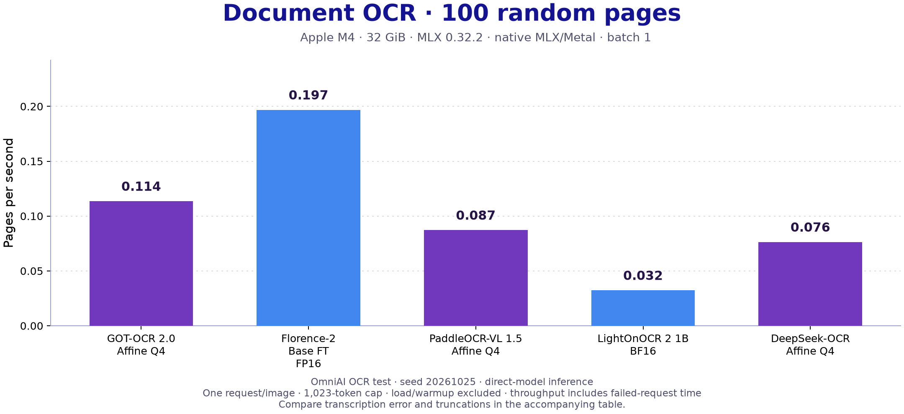
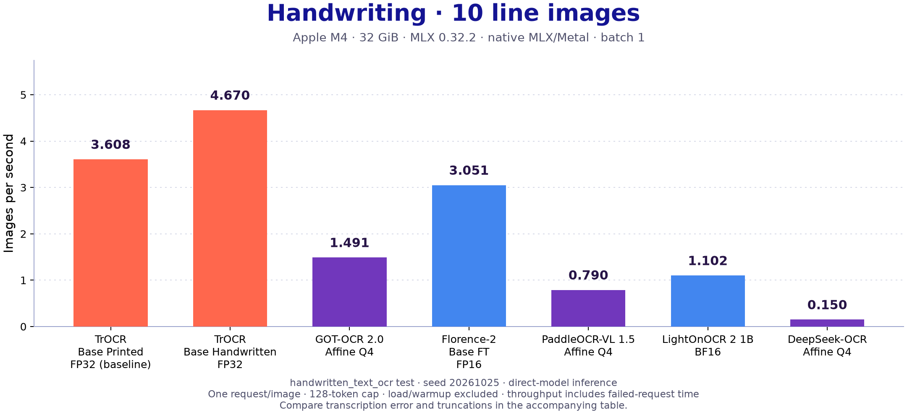

# OCR performance

[Benchmark navigation](../README.md) · [Generation ownership](../../documentation-generation.md)

<!-- MLX-ONE-OCR-BENCHMARK-START -->
## OCR Model Performance

Experimental native OCR on **100 randomly selected document images** from [OmniAI OCR Benchmark](https://huggingface.co/datasets/getomni-ai/ocr-benchmark). All page models use the same pinned sample (seed 20261025).

**Apple M4, 32 GiB unified memory · MLX 0.32.2 · direct-model inference · native MLX/Metal · batch 1.** One 16-token warmup, then one timed request per image; image-dependent input lengths and a 1,023-token output cap, greedy decoding. Actual token counts are retained in JSON. Latency is the median of completed requests; pages/s is completed pages divided by total inference time, including failed requests. Peak memory is the maximum observed MLX allocation, including weights.

| Model | Precision | Completed | Median latency (s) | Pages/s | Markdown-ref. CER ↓ | Peak MLX (GiB) | Truncated |
|---|---|---:|---:|---:|---:|---:|---:|
| [TrOCR Base Printed](omni100-20261025/O01.json) | FP32 | [Line crops required](omni100-20261025/O01.json) | — | — | — | — | — |
| [TrOCR Base Handwritten](omni100-20261025/O02.json) | FP32 | [Line crops required](omni100-20261025/O02.json) | — | — | — | — | — |
| [GOT-OCR 2.0](omni100-20261025/O03.json) | Affine Q4 | [97/100](omni100-20261025/O03.json) | 12.42 | **0.114** | 74.5% | 1.673 | 56 |
| [Florence-2 Base FT](omni100-20261025/O04.json) | FP16 | [97/100](omni100-20261025/O04.json) | 6.60 | **0.197** | 78.3% | 1.201 | 61 |
| [PaddleOCR-VL 1.5](omni100-20261025/O05.json) | Affine Q4 | [97/100](omni100-20261025/O05.json) | 13.87 | **0.087** | 59.8% | 1.560 | 53 |
| [LightOnOCR 2 1B](omni100-20261025/O06.json) | BF16 | [97/100](omni100-20261025/O06.json) | 31.53 | **0.032** | 67.7% | 8.661 | 64 |
| [DeepSeek-OCR](omni100-20261025/O07.json) | Affine Q4 | [97/100](omni100-20261025/O07.json) | 13.59 | **0.076** | 51.2% | 3.810 | 41 |

CER uses NFKC and whitespace normalization against Markdown references; formatting and reading order affect this score, which can exceed 100%. Failed requests count as empty predictions. This is an MLX-One corpus test, separate from OmniAI’s official leaderboard and the synthetic OCR-S* protocol.

TrOCR requires annotated line crops, absent from this page dataset. PaddleOCR-VL uses direct page transcription; its separate layout pipeline is not included. No layout accuracy or JSON extraction score is claimed by this page test.

[Methodology, per-image predictions and cleanup evidence](omni100-20261025/README.md) · [OCR limitations and manual commands](../../OCR_TESTING.md)

### Handwriting: 10 line images

The same seeded sample of 10 test-split images from [handwritten_text_ocr](https://huggingface.co/datasets/toghrultahirov/handwritten_text_ocr). One 16-token warmup; one request per image; image-dependent input lengths; 128-token output cap. Micro CER/WER use the supplied plain-text references after NFKC and whitespace normalization; failed requests count as empty outputs.

**Apple M4, 32 GiB · MLX 0.32.2 · native MLX/Metal · direct-model inference · batch 1.**

| Model | Precision | Completed | Median latency (s) | Images/s | CER ↓ | WER ↓ | Peak MLX (GiB) | Truncated |
|---|---|---:|---:|---:|---:|---:|---:|---:|
| [TrOCR Base Printed (printed baseline)](hand10-20261025/O01.json) | FP32 | [10/10](hand10-20261025/O01.json) | 0.27 | **3.608** | 80.6% | 100.0% | 1.488 | 0 |
| [TrOCR Base Handwritten](hand10-20261025/O02.json) | FP32 | [10/10](hand10-20261025/O02.json) | 0.21 | **4.670** | 4.4% | 10.6% | 1.488 | 0 |
| [GOT-OCR 2.0](hand10-20261025/O03.json) | Affine Q4 | [10/10](hand10-20261025/O03.json) | 0.67 | **1.491** | 40.6% | 94.7% | 1.673 | 0 |
| [Florence-2 Base FT](hand10-20261025/O04.json) | FP16 | [10/10](hand10-20261025/O04.json) | 0.30 | **3.051** | 97.9% | 143.6% | 1.201 | 1 |
| [PaddleOCR-VL 1.5](hand10-20261025/O05.json) | Affine Q4 | [10/10](hand10-20261025/O05.json) | 1.13 | **0.790** | 13.8% | 43.6% | 1.540 | 0 |
| [LightOnOCR 2 1B](hand10-20261025/O06.json) | BF16 | [10/10](hand10-20261025/O06.json) | 0.98 | **1.102** | 6.9% | 33.0% | 2.766 | 0 |
| [DeepSeek-OCR](hand10-20261025/O07.json) | Affine Q4 | [10/10](hand10-20261025/O07.json) | 6.68 | **0.150** | 24.7% | 48.9% | 3.810 | 0 |

TrOCR Printed is an out-of-domain baseline. Page models process the same cropped lines in their OCR mode; this small sample is not a general handwriting qualification. Handwriting timings are separate from the 100-page workload. [Protocol, predictions, truncations and coverage](hand10-20261025/README.md).

<!-- MLX-ONE-OCR-BENCHMARK-END -->
