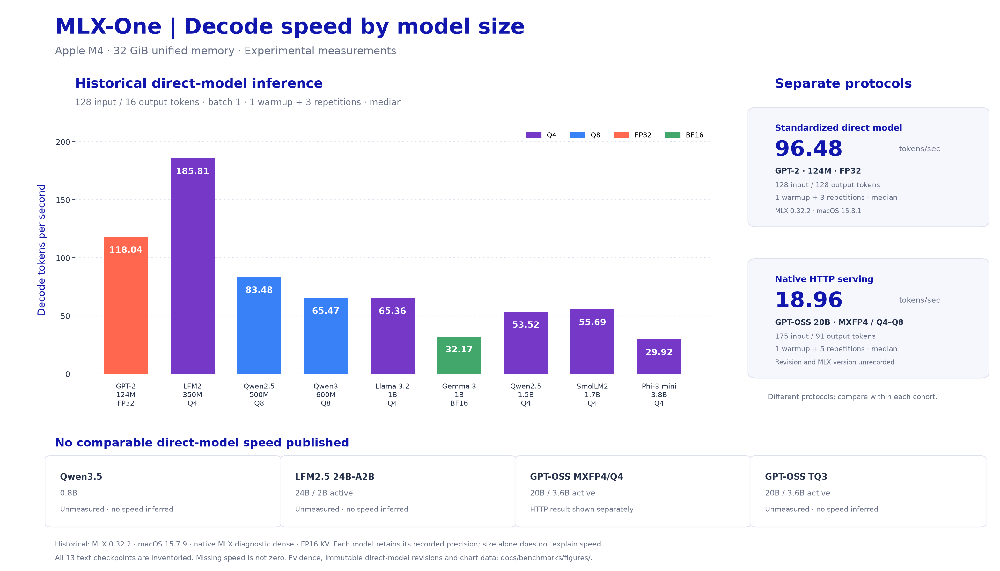

# Text model performance

[Benchmark navigation](README.md) · [Generation ownership](../documentation-generation.md)

<!-- model-performance:start -->
## Model Performance

Actual **direct-model inference** measurements; experimental, batch size 1. Python Engine, CLI and HTTP serving throughput are separate measurement types and are not represented by these numbers. Parameters are nominal model sizes.

Configured context windows come from the pinned checkpoint configs; they are separate from benchmark input lengths and do not establish full-window validation. See the [config sources](inventory.md).

[Model size vs decode speed scatter plot](figures/text-model-size-vs-decode.svg) · [Bar chart SVG](figures/text-model-decode-bars.svg) · [Chart data and reproduction](figures/README.md). Protocols are shown separately; checkpoints without comparable measurements remain unmeasured.

**Historical 128-input / 16-output protocol.** These archived runs are not the new standardized 128-input / 128-output results. Source and primary precision measurements are listed separately; “source” means the stored weights.

**historical-128-16** — Apple M4, 32 GB; macOS-15.7.9-arm64-arm-64bit; Python 3.12.11; MLX 0.32.2 / Metal 0.32.2. Backend: native MLX diagnostic dense; full sequence logits; production_fp16 KV. Actual input: 128 tokens; actual output: 16 tokens per repetition. 1 shape warmup; 3 measured repetitions; per-column median. FP16 KV; fresh state, no prefix reuse. TTFT includes prefill and greedy selection of the first token. Peak MLX resets before each request after load/conversion/warmup; it includes resident model allocations.

| Model name | Parameters | Configured context (tokens) | Quantization/precision | Prefill tokens/sec | Decode tokens/sec | Time to first token (ms) | Peak MLX memory (GiB) |
|---|---|---:|---|---:|---:|---:|---:|
| [openai-community/gpt2](historical/M01-stored-performance.json) | 124M | 1,024 | FP32 | **6722.29** | **118.04** | 19.04 | 0.594 |
| [Qwen/Qwen2.5-0.5B-Instruct](historical/M02-affine_q8-performance.json) | 0.5B | 32,768 | Affine Q8 (group 64) | **2001.96** | **83.48** | 63.94 | 0.632 |
| [Qwen/Qwen2.5-0.5B-Instruct](historical/M02-stored-performance.json) | 0.5B | 32,768 | BF16 (source) | **1801.11** | **50.49** | 71.07 | 1.068 |
| [Qwen/Qwen3-0.6B](historical/M03-affine_q8-performance.json) | 0.6B | 40,960 | Affine Q8 (group 64) | **1275.02** | **65.47** | 100.39 | 0.816 |
| [Qwen/Qwen3-0.6B](historical/M03-stored-performance.json) | 0.6B | 40,960 | BF16 (source) | **892.22** | **33.95** | 143.46 | 1.312 |
| [LiquidAI/LFM2-350M](historical/M04-affine_q4-performance.json) | 350M | 128,000 | Affine Q4 (group 64) | **3180.66** | **185.81** | 40.24 | 0.313 |
| [LiquidAI/LFM2-350M](historical/M04-stored-performance.json) | 350M | 128,000 | BF16 (source) | **3169.32** | **91.87** | 40.39 | 0.783 |
| [HuggingFaceTB/SmolLM2-1.7B-Instruct](historical/M06-affine_q4-performance.json) | 1.7B | 8,192 | Affine Q4 (group 64) | **384.06** | **55.69** | 333.28 | 1.202 |
| [HuggingFaceTB/SmolLM2-1.7B-Instruct](historical/M06-stored-performance.json) | 1.7B | 8,192 | BF16 (source) | **309.63** | **19.21** | 413.39 | 3.390 |
| [meta-llama/Llama-3.2-1B-Instruct](historical/M07-affine_q4-performance.json) | 1B | 131,072 | Affine Q4 (group 64) | **374.73** | **65.36** | 341.58 | 0.886 |
| [meta-llama/Llama-3.2-1B-Instruct](historical/M07-stored-performance.json) | 1B | 131,072 | BF16 (source) | **572.81** | **29.75** | 223.46 | 2.455 |
| [Qwen/Qwen2.5-1.5B-Instruct](historical/M08-affine_q4-performance.json) | 1.5B | 32,768 | Affine Q4 (group 64) | **411.23** | **53.52** | 311.26 | 1.034 |
| [Qwen/Qwen2.5-1.5B-Instruct](historical/M08-stored-performance.json) | 1.5B | 32,768 | BF16 (source) | **375.86** | **21.46** | 340.55 | 3.044 |
| [google/gemma-3-1b-it](historical/M09-stored-performance.json) | 1B | 32,768 | BF16 | **675.56** | **32.17** | 189.47 | 2.028 |
| [microsoft/Phi-3-mini-4k-instruct](historical/M10-affine_q4-performance.json) | 3.8B | 4,096 | Affine Q4 (group 64) | **159.64** | **29.92** | 801.79 | 2.357 |
| [microsoft/Phi-3-mini-4k-instruct](historical/M10-stored-performance.json) | 3.8B | 4,096 | BF16 (source) | **126.13** | **10.87** | 1014.81 | 7.256 |

**standard-128-128** — Apple M4, 32 GB; macOS-15.8.1-arm64-arm-64bit; Python 3.12.11; MLX 0.32.2 / Metal 0.32.2. Backend: native MLX direct dense; last_only logits; production_fp16 KV. Actual input: 128 tokens; actual output: 128 tokens per repetition. 1 shape warmup; 3 measured repetitions; per-column median. FP16 KV; fresh state, no prefix reuse. TTFT includes prefill and greedy selection of the first token. Peak MLX resets before each request after load/conversion/warmup; it includes resident model allocations.

| Model name | Parameters | Configured context (tokens) | Quantization/precision | Prefill tokens/sec | Decode tokens/sec | Time to first token (ms) | Peak MLX memory (GiB) |
|---|---|---:|---|---:|---:|---:|---:|
| [openai-community/gpt2](runs/M01-direct-128-128.json) | 124M | 1,024 | FP32 | **4057.67** | **96.48** | 31.55 | 0.570 |

**Standardized 128/128 coverage: 1 / 13 primary configurations.** Remaining runs are pending; see the coverage report.

**Missing primary-precision performance:** `Qwen/Qwen3.5-0.8B`, `LiquidAI/LFM2.5-24B-A2B-MLX-4bit`, `mlx-community/gpt-oss-20b-MXFP4-Q4`, `manjunathshiva/gpt-oss-20b-tq3`. No speed or memory figures are inferred for these checkpoints.

See the [methodology and manual commands](README.md), [checkpoint/precision inventory](inventory.md), and [coverage report](coverage.md). Full samples, output token IDs, immutable revisions, source hashes and hardware evidence live in [docs/benchmarks](.).
<!-- model-performance:end -->
