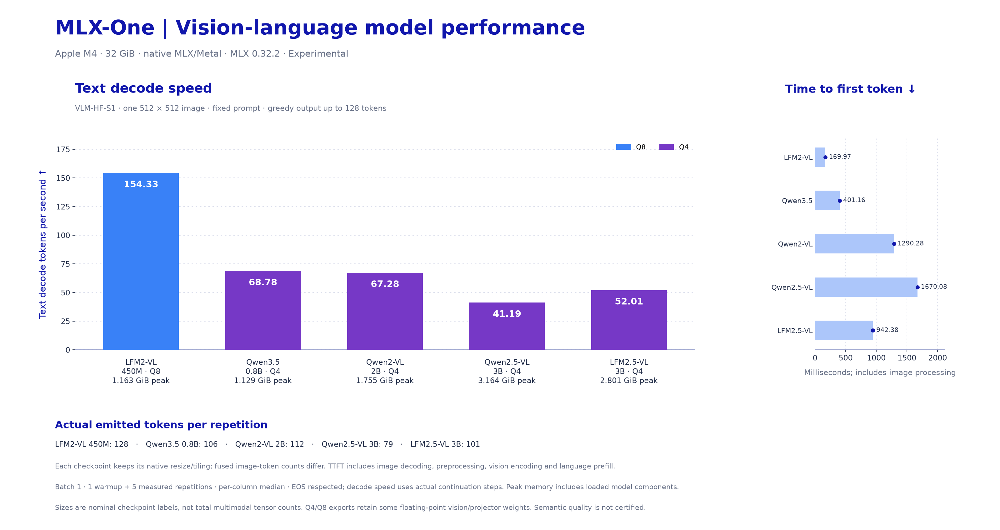

# Vision-language performance

[Benchmark navigation](../README.md) · [Generation ownership](../../documentation-generation.md)

<!-- MLX-ONE-VLM-BENCHMARK-START -->
## Vision-Language Model Performance

Actual **direct-model native MLX/Metal** inference on pinned checkpoint revisions. These are image-inference measurements; Python Engine, CLI and HTTP serving overhead are separate. Functional and quality limits are recorded with the evidence.

**VLM-HF-S1 v1:** one 512 × 512 padded image from [Hugging Face documentation-images](https://huggingface.co/datasets/huggingface/documentation-images), with dataset revision and image hashes pinned in the [workload manifest](../../../benchmarks/vlm/hf-images.json). Batch 1, fixed prompt, greedy generation up to 128 emitted tokens; one warmup and five repetitions, per-column median. EOS is respected and actual output counts determine speed. Each checkpoint retains its own resize/tiling. TTFT includes image decoding/preprocessing; prefill combines vision encoding, projection and language prefill. “Vision processing” means image decoding/preprocessing only.

Q4/Q8 denote the published checkpoint format; vision or projector modules may retain floating-point weights.

[VLM size-versus-speed scatter plot](../figures/vlm-model-size-vs-decode.svg) · [VLM chart SVG](../figures/vlm-model-performance.svg) · [Chart data and reproduction](../figures/README.md#vlm-and-audio-charts)

**Measured hardware:** Apple M4, 32 GiB; macOS-15.8.1-arm64-arm-64bit; MLX 0.32.2; Python 3.12.11. Separate execution cohort.

| Model | Precision | Images | Vision processing (ms) | Prefill TPS | Decode TPS | TTFT (ms) | Peak MLX memory (GiB) | Scores |
|---|---|---:|---:|---:|---:|---:|---:|---|
| [Qwen2-VL 2B](results/V01-VLM-HF-S1.json) | Q4 | 1 | 6.05 | **279.68** | **67.28** | 1290.28 | 1.755 | [Scores](results/V01-VLM-HF-S1.json) |
| [Qwen2.5-VL 3B](results/V02-VLM-HF-S1.json) | Q4 | 1 | 6.05 | **215.86** | **41.19** | 1670.08 | 3.164 | [Scores](results/V02-VLM-HF-S1.json) |
| [Qwen3.5 0.8B](results/V03-VLM-HF-S1.json) | Q4 | 1 | 4.81 | **717.75** | **68.78** | 401.16 | 1.129 | [Scores](results/V03-VLM-HF-S1.json) |
| [LFM2-VL 450M](results/V04-VLM-HF-S1.json) | Q8 | 1 | 7.16 | **1739.05** | **154.33** | 169.97 | 1.163 | [Scores](results/V04-VLM-HF-S1.json) |
| [LFM2.5-VL 3B](results/V05-VLM-HF-S1.json) | Q4 | 1 | 7.37 | **300.73** | **52.01** | 942.38 | 2.801 | [Scores](results/V05-VLM-HF-S1.json) |

**Actual fused input / emitted output tokens per repetition:** Qwen2-VL 2B: 359 / 112; Qwen2.5-VL 3B: 359 / 79; Qwen3.5 0.8B: 284 / 106; LFM2-VL 450M: 282 / 128; LFM2.5-VL 3B: 281 / 101.

High-resolution (1024 × 1024), four-image and OCR workloads remain separate. The HF image protocol is not pooled with the earlier synthetic-image protocol. See the [methodology and coverage](README.md), [pinned checkpoint inventory](benchmark_plan.json), and [manual download/inference/benchmark runbook](../../VLM_TESTING.md). Text-model measurements above use different protocols. See the [checkpoint smoke and cleanup report](../../validation/vlm-hf-2026-10-24/report.md).
<!-- MLX-ONE-VLM-BENCHMARK-END -->
