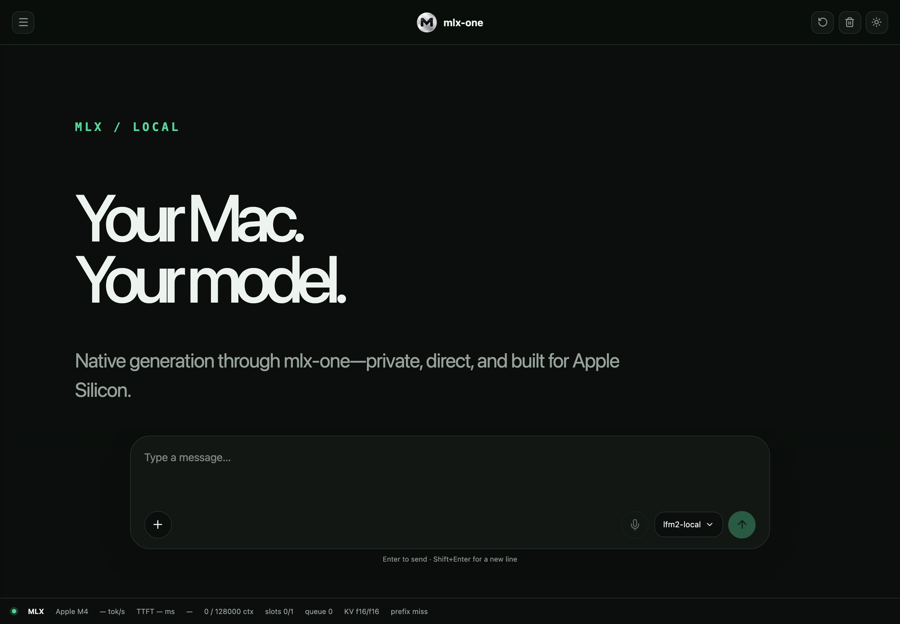

# Getting started

## Installation

mlx-one requires Python 3.10 or newer and an Apple Silicon Mac with macOS 15 or
later for model execution. The current MLX/Metal pair is pinned to 0.32.2;
Python 3.12.11 is the tested development environment.

### Install from PyPI

Install the published alpha directly:

```bash
python -m pip install "mlx-one==0.1.0a1"
```

Include the HTTP server, vision and OCR dependencies with:

```bash
python -m pip install "mlx-one[server,vision,ocr]==0.1.0a1"
mlx-one --version
mlx-one registry list
```

The [0.1.0a1 release notes](https://github.com/SSusantAchary/mlx-one/releases/tag/0.1.0a1)
link the [PyPI release](https://pypi.org/project/mlx-one/0.1.0a1/), distribution
artifacts and recorded validation. Model weights are acquired separately under
their publishers' terms.

### Source installation for development

Clone the repository for an editable development installation:

```bash
git clone https://github.com/SSusantAchary/mlx-one.git
cd mlx-one
python3 -m venv .venv
source .venv/bin/activate
python -m pip install -e .
```

Install development tools with:

```bash
python -m pip install -e ".[dev]"
```

To reproduce the recorded Apple M4 / Python 3.12.11 candidate dependencies, use
`python -m pip install -c requirements/alpha-tested-constraints.txt -e ".[dev]"`
inside a Python 3.12.11 environment. These constraints are an environment snapshot,
not a lockfile for every supported Python version. On Python 3.10, 3.11 or 3.13,
install without that constraints file and validate the resolved environment.
See [dependency policy and tested minimums](../requirements/README.md).

### Optional dependencies and model assets

Qwen known-text alignment has separate optional language dependencies:

```bash
python -m pip install "mlx-one[qwen-align-ja]==0.1.0a1"  # Japanese: nagisa==0.2.11
python -m pip install "mlx-one[qwen-align-ko]==0.1.0a1"  # Korean: soynlp==0.0.493
```

Korean alignment also needs the checksummed `korean_dict_jieba.dict` in the local
checkpoint directory. The extra installs only the tokenizer. See the
[alignment asset instructions](../src/mlx_one/models/audio/qwen3_asr/README.md#installation-and-assets).

The native engine and server do not require `mlx-lm`. Install
`mlx-one[legacy-mlx-lm]` only for legacy compatibility workflows that explicitly
request that bridge.

For SAM3 image processing, install the existing vision extra:

```bash
python -m pip install "mlx-one[vision]==0.1.0a1"
```

Meta's [SAM3 checkpoint](https://huggingface.co/facebook/sam3) requires authorized
gated access and acceptance of its separate checkpoint license. Authenticate with
`hf auth login`, or use an authorized complete local snapshot with `--offline`.
SAM3 runs in float32; quantized checkpoints and SAM3.1 are unsupported.

FFmpeg is required when the Whisper/Moonshine/Qwen/Parakeet API receives an audio file; encoded SAM3
videos require both FFmpeg and ffprobe. Decoded mono 16-kHz waveforms, SAM3 frame
directories, and Python RGB frame iterators need no video/audio decoder.

## Quick start

### Native server and Web UI

Load one supported text model and start the bundled local UI:

```bash
python -m pip install "mlx-one[server]==0.1.0a1"
mlx-one serve Qwen/Qwen3-0.6B --inference-mode reference_dense
```

<p align="center">
  <a href="../mlx_One_chat_ui.png">
    
  </a>
</p>

Click the thumbnail to open the full-size UI screenshot.

To expose a shorter model name and protect `/v1/*` with a Bearer key:

```bash
mlx-one serve LiquidAI/LFM2-350M \
  --host 127.0.0.1 \
  --port 8181 \
  --alias lfm2-local \
  --api-key local-secret
```

To enable the UI microphone and audio-file transcription, load a private native Whisper sidecar:

```bash
mlx-one serve CHAT_MODEL \
  --transcription-model WHISPER_MODEL \
  --host 127.0.0.1 \
  --port 8181
```

The Whisper model is loaded only when this flag is supplied. Recordings stay local, are
transcribed through MLX, and the editable transcript is inserted into the composer without being
sent automatically. FFmpeg is required for browser audio decoding.

Enter `local-secret` in the UI's **API key** field and select **Connect**. Terminal clients must
send the same key and use the alias as the request model:

```bash
curl http://127.0.0.1:8181/v1/models \
  -H 'Authorization: Bearer local-secret'

curl -N http://127.0.0.1:8181/v1/chat/completions \
  -H 'Authorization: Bearer local-secret' \
  -H 'Content-Type: application/json' \
  -d '{"model":"lfm2-local","messages":[{"role":"user","content":"Explain MLX in one sentence."}],"stream":true}'
```

Authentication is disabled when neither `--api-key` nor `MLX_ONE_API_KEY` is configured. A
`401 Unauthorized` response from `/v1/*` means the Bearer key is missing or invalid; `/health`
and the static UI remain public.

The native server also supports model aliases, optional Bearer authentication, effective context
limits, request deadlines, cooperative parallel slots, prompt/context caching, context shifting,
reasoning output, quantized KV caches, and Qwen3.5 MTP speculative decoding. Run
`mlx-one serve --help` for the complete flag list.

Cache Runtime V1 keeps dense KV as the default and exposes the Qwen2/Qwen2.5 block backend as an
opt-in experimental path:

```bash
mlx-one serve MODEL --cache-backend block --kv-block-size 32 \
  --kv-cache-budget-mib 8192 --prefix-cache-mib 512
```

The block backend currently requires unquantized f16 Qwen2/Qwen2.5 text generation with batch size
one. Unsupported combinations fail explicitly. Runtime cache ownership, memory, reservation, block,
and prefix statistics are included in `GET /v1/runtime`.

> [!WARNING]
> M4/32 GB qualification is incomplete. An unquantized Qwen2.5-0.5B dense run completed through
> 16K input tokens but failed at approximately 32K under the current memory budget. Dense snapshot
> APC did not reuse divergent chat-prompt suffixes, so block APC, block sharing, and dense/block
> parity are not qualified. Keep dense as the recommended backend; use block mode only for
> development testing. Hybrid LFM models reject block KV and APC intentionally. See the measured
> [cache qualification report](cache-benchmark-m4-32gb.md) and
> [runtime support matrix](cache-runtime.md).

With the default port, open `http://127.0.0.1:8888` (or `http://127.0.0.1:8181`
for the explicit-port examples above). The same process exposes an OpenAI-compatible
API at `/v1`, including streaming chat completions. Model execution remains inside
mlx-one's native model, tokenizer, sampling, generation, and MLX runtime. See
[the Web UI and server guide](ui.md) for API and development details.

### Inspect, plan, and run tasks

Check the machine and inspect a model without loading its weights:

```bash
mlx-one doctor

mlx-one inspect Qwen/Qwen2.5-1.5B
```

Build a workload-aware memory plan:

```bash
mlx-one plan inference \
  --model Qwen/Qwen2.5-1.5B \
  --hardware m4-air-32gb \
  --precision bf16 \
  --context-length 2048
```

Generate text through the native GPT-2 stack:

```bash
mlx-one generate openai-community/gpt2 "The future of local AI is" \
  --max-tokens 64 \
  --temperature 0.8 \
  --top-p 0.95 \
  --seed 0
```

Use `--stream` for incremental text, `--json-output` for a structured result,
or `--offline` with an existing local/cache copy. Model downloads occur only
when a user explicitly supplies an online repository without `--offline`.

Transcribe audio through the native Whisper stack:

```bash
mlx-one transcribe openai/whisper-tiny recording.m4a \
  --language en \
  --word-timestamps \
  --json-output
```

Omit `--language` for automatic detection. Add `--task translate` for
speech-to-English translation or `--offline` to require local/cached assets.

Create document or instructed query embeddings:

```bash
mlx-one embed Qwen/Qwen3-Embedding-0.6B "A document to index" \
  --dimensions 512 \
  --json-output

mlx-one embed Qwen/Qwen3-Embedding-0.6B "local Apple Silicon training" \
  --input-type query
```

Rerank candidate documents while preserving their original indexes:

```bash
mlx-one rerank Qwen/Qwen3-Reranker-0.6B \
  "Which Macs support MLX?" \
  "MLX is designed for Apple silicon." \
  "CUDA targets NVIDIA GPUs." \
  --top-k 1 \
  --json-output
```

For reproducible evaluation and qualification, add `--revision` with an exact
model commit. Raw commit hashes are kept in integration tests and evidence
records rather than introductory examples.
