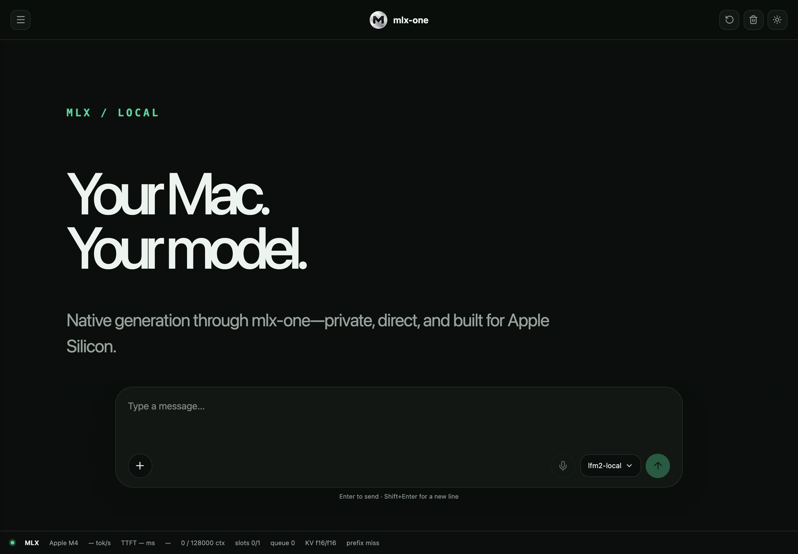

<div class="mlx-hero" markdown>

<span class="mlx-eyebrow">NATIVE MLX · APPLE SILICON</span>

# One stack. Native MLX.<br>Built for Apple Silicon.

Run text, vision, audio and more through one native inference library.
Go from your first local generation to a Python application, CLI workflow
or HTTP service—with the model guides and measurements alongside you.
{ .mlx-lead }

[Get started](getting-started.md){ .md-button .md-button--primary }
[Explore the models](models/index.md){ .md-button }

<div class="mlx-install" markdown>

```bash
python -m pip install "mlx-one==0.1.0a1"
```

Python 3.10+ · macOS 15+ · Apple Silicon
{ .mlx-install-note }

</div>
</div>

## From your Mac to your application

MLX-One owns its native model implementations, checkpoint loading, tokenization
and generation. Apple MLX and Metal provide tensor execution on unified memory.
The same library exposes task-specific Python APIs, a CLI and local HTTP serving.

=== "Python"

    ```python
    from mlx_one import Engine

    with Engine(model="openai-community/gpt2") as engine:
        result = engine.generate("The future of local AI is", max_tokens=64)
        print(result.text)
    ```

=== "CLI"

    ```bash
    mlx-one generate openai-community/gpt2 "The future of local AI is" \
      --max-tokens 64 --temperature 0.8 --seed 0
    ```

=== "HTTP server"

    ```bash
    python -m pip install "mlx-one[server]==0.1.0a1"
    mlx-one serve LiquidAI/LFM2-350M --alias lfm2-local \
      --host 127.0.0.1 --port 8888 --inference-mode reference_dense
    ```

## Find your guide

<div class="grid cards" markdown>

- **Generate text**

    Load a checkpoint, sample a response and stream tokens.

    [Text generation →](guides/generate.md)

- **Build a local service**

    Connect the chat UI or your app to the HTTP API.

    [Serving and Web UI →](guides/serve.md)

- **Work with images and documents**

    Explore native vision-language and OCR workflows.

    [Vision-language →](guides/vision.md) · [OCR →](guides/ocr.md)

- **Transcribe and work with audio**

    Find speech recognition, alignment and speech-generation scope.

    [Audio and speech →](guides/audio.md)

- **Embed, retrieve and rerank**

    Create vectors and score candidate documents through native APIs.

    [Retrieval →](guides/retrieval.md)

- **Segment images and track video**

    Use SAM3’s dedicated image and video workflows.

    [Segmentation and tracking →](models/segmentation/sam3.md)

</div>

## See it running locally

[](../../mlx_One_chat_ui.png)

A local chat interface backed by the same native model runtime.
[Run the server](guides/serve.md) to open it in your browser.

## Measurements you can follow back to the source

[Performance across all modalities](performance/index.md) keeps text, VLM,
audio, OCR, HTTP and task timings visible, with hardware and workload boundaries.
Detailed reports link the original evidence. Missing measurements remain marked
as unavailable; a measured workload is distinct from a qualified checkpoint.

[Explore performance](performance/index.md){ .md-button }

## One place to understand model coverage

The [model index](models/index.md) connects family implementations to their
guides. The [checkpoint inventory](reference/checkpoints.md) records exact
revisions and precision. Use the [admission policy](reference/admission.md)
when you need the evidence behind a support claim.

Native MLXBoost acceleration is optional and experimental, with reference
execution as the default. Detailed optimization work, failures and remaining
gates live in [experimental documentation](experimental/index.md).

---

[GitHub](https://github.com/SSusantAchary/mlx-one) ·
[PyPI](https://pypi.org/project/mlx-one/0.1.0a1/) ·
[Architecture](reference/architecture.md) ·
[Citation and license](reference/citation.md)
